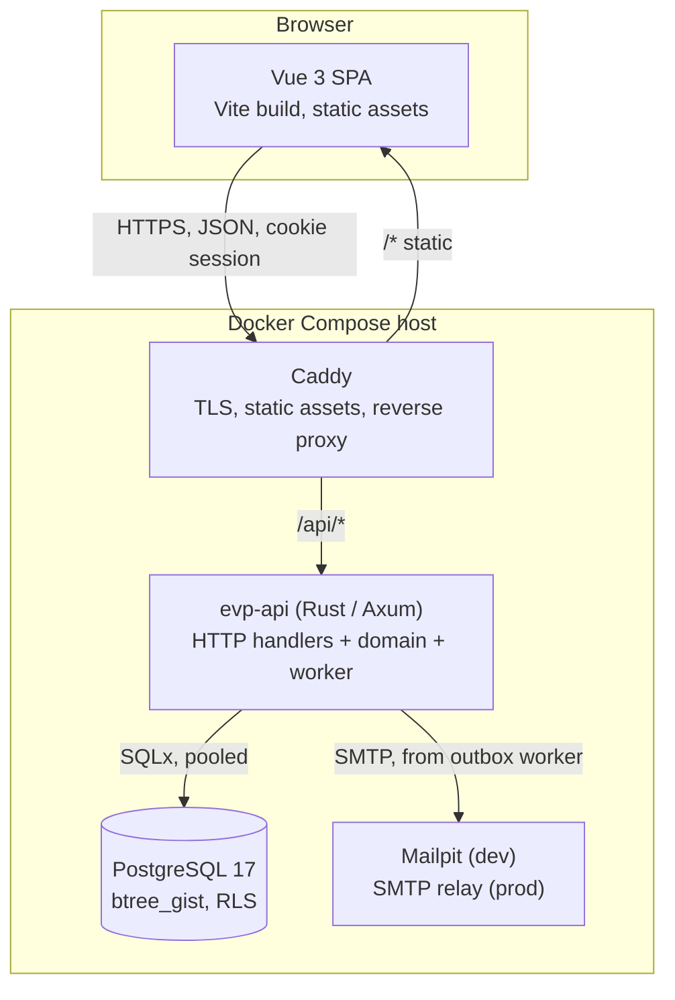

# 02 — Architecture

## 1. Shape of the system

A conventional three-tier application: a Vue SPA, a Rust API, and PostgreSQL.
There is deliberately nothing else in the critical path.



The API binary contains both the HTTP server and the background worker. At this
scale they do not need separate processes, and keeping them in one binary means
one thing to build, ship and monitor. The worker is behind a flag
(`EVP_RUN_WORKER=true`) so that splitting it out later is a compose change, not
a rewrite.

## 2. Technology choices

| Layer | Choice | Rationale |
| --- | --- | --- |
| UI framework | **Vue 3** (`<script setup>`, Composition API) + TypeScript | Requested. Composition API keeps the scheduling logic testable outside components. |
| Build | **Vite** | Native to Vue 3, fast, and produces plain static assets Caddy can serve. |
| Routing | **Vue Router** | Standard. |
| Server state | **TanStack Query (Vue)** | The app is mostly a cache of server data. Query handles invalidation, retries, and optimistic updates for drag-and-drop far better than hand-rolled store code. |
| Client state | **Pinia** | Only for genuinely client-side state: current org, timeline zoom, selection, filters. Server data does *not* go in Pinia. |
| Styling | **Tailwind CSS** + a small set of local primitives | The timeline is a bespoke CSS-grid component; a heavy component library would be fought more than used. |
| Rich text, frontend | **Tiptap** (ProseMirror), admin only | The schedule email template is written by coordinators who should not see HTML. A schema limited to what mail clients render means pasted content cannot carry anything else in, and placeholders are atoms that cannot be half-deleted ([ADR-0046](adr/0046-email-template-edited-as-rich-text-stored-as-html.md)). |
| Dates, frontend | **Temporal** (polyfilled) | Event-timezone-aware formatting is a first-class requirement; `Date` is not adequate ([16 §4](16-i18n-and-time.md#4-libraries)). |
| Dates, backend | **jiff** | Its `Zoned` type carries an instant *and* a zone, so DST gaps and folds are explicit in the API instead of silently resolved ([ADR-0019](adr/0019-time-discipline.md)). |
| HTTP server | **Axum 0.8** on Tokio | Requested Rust. Axum's extractor model makes the tenant-scoping middleware clean, and it sits directly on `tower`, so tracing, timeouts and rate limits are middleware rather than bespoke code. |
| DB access | **SQLx** with compile-time-checked queries | Verifies SQL against a real schema at build time. Given the schema carries the correctness guarantees (see below), a query layer that lies about types would undermine that. Chosen over an ORM because the interesting queries — coverage, overlap, availability — are set-based SQL that an ORM obscures. |
| Migrations | **`sqlx migrate`** | Plain, ordered `.sql` files, applied at API startup, checksummed. |
| API contract | **utoipa** → OpenAPI 3.1 → generated TS client | One source of truth. The frontend never hand-writes request/response types. *Not built yet:* until it is, the admin's API modules declare valibot schemas by hand ([11 §3](11-engineering-standards.md#3-typescript)). |
| Errors | **thiserror** (domain) + a single Axum `IntoResponse` mapper | Domain errors carry meaning; only one place turns them into HTTP. |
| Observability | **tracing** + `tracing-subscriber` JSON, `/healthz`, `/readyz`, Prometheus `/metrics` | Structured logs with a request id and org id on every span. |
| Auth | One generic OIDC client (**openidconnect**) over configured providers, plus magic links; both issue opaque server-side sessions | Any OIDC-compliant provider works with no code, because the project is open source and other deployments are not Google-based. Implemented directly rather than behind an identity provider, since authorisation is row-level and tenant-scoped and cannot live in token claims. [ADR-0014](adr/0014-pluggable-oidc-providers.md), [ADR-0013](adr/0013-google-oidc-without-an-identity-provider.md), [ADR-0005](adr/0005-magic-link-authentication.md). |
| Email | **lettre** over SMTP, templates via **minijinja** | No SaaS lock-in; Mailpit locally, any relay in prod. |
| SMS | HTTP provider behind an `SmsSender` trait; OVH first | Already in use in the current system, so in scope from the start. The trait keeps Twilio or another provider a config change. Messages are transliterated to GSM-7 so a schedule stays inside one paid segment. |
| PDF export | **Typst** CLI, or `printpdf` | Roster sheets are typographic documents; Typst templates are far more maintainable than imperative PDF calls. |
| Proxy | **Caddy** | Automatic TLS, trivial static-file serving, ~15 MB image. |

Rust here is not a performance decision — at 500 volunteers almost anything
would be fast enough. It is chosen for a small static binary with a tiny
runtime footprint, an exhaustive type system that makes the state machines
(assignment status, roster publication) hard to get wrong, and no runtime to
keep patched. The cost is honest: slower iteration than a TypeScript backend,
and a smaller pool of people who can pick the project up.

## 3. Backend structure

A Cargo workspace, layered so that the domain logic does not know about HTTP or
SQL. This is what makes the constraint engine unit-testable without a database.

```
crates/
  evp-domain/      # Pure: entities, value objects, constraint engine, no I/O
  evp-db/          # SQLx repositories, migrations, RLS session handling
  evp-api/         # Axum routers, extractors, DTOs, OpenAPI, error mapping
  evp-intake/      # Source connectors, mapping/transform engine, reconciliation
                   #   (today: first-party form mapping + reconciliation only)
  evp-worker/      # Outbox consumer: email, ICS, sheet polling, batch mapping
                   #   (today: the OVH SMS sender and GSM-7, not yet wired)
  evp-cli/         # Admin tasks: seed, import, create-org, backfill
                   #   (today: reconcile; create-org, seed, rotate-app-key are stubs)
  evp-bin/         # Composition root: config, wiring, main()
```

Dependency direction is strictly inward: `api` and `worker` depend on `domain`
and `db`; `domain` depends on neither. `evp-intake` holds the mapping and
reconciliation engine, which — like the constraint engine — is a pure function
over stored raw payloads, so it is testable without a database and safe to
replay.

### Request lifecycle

A write request, end to end:

1. **Caddy** terminates TLS and proxies `/api/*` to the API.
2. **`tower-http` middleware**: request id, tracing span, body-size limit,
   timeout, CORS (dev only — same origin in prod).
3. **Session extractor** reads the `evp_session` cookie, looks up the opaque
   session in Postgres, and rejects unauthenticated requests. It makes no
   distinction between how the session was established — which provider proved
   identity is recorded in `identities` and does not affect the request path.
4. **Org extractor** resolves the organisation from the path
   (`/api/orgs/{org_id}/...`), verifies the caller has a membership, and
   attaches `(user_id, org_id, role)` to the request.
5. **Transaction** begins. Immediately: `SET LOCAL app.current_org_id = $1`
   and `SET LOCAL app.current_role = $2`. Row-Level Security policies key off
   these, so the tenant boundary holds even if a handler forgets a `WHERE`.
6. **Handler** deserialises and validates the DTO, then calls a domain service.
7. **Domain service** loads what it needs through a repository trait, runs the
   constraint engine, and returns either a rejection or a set of changes.
8. **Repository** persists the changes, writes an audit-log row, and enqueues
   any outbox messages — all in the same transaction.
9. **Commit.** Response serialised, `ETag` set where optimistic concurrency
   applies.
10. **Worker**, separately, picks up outbox rows and sends email.

Step 5 is the load-bearing one for a multi-tenant system, and step 8 is what
makes "the email was sent but the assignment was rolled back" impossible.

## 4. Multi-tenancy

Shared database, shared schema, `org_id` on every tenant-owned table, with
**PostgreSQL Row-Level Security as the enforcing layer**.

The application also filters by `org_id` in its queries — belt and braces — but
the security guarantee comes from the database. The reasoning: in a system with
a few dozen tables and hundreds of queries, the probability that every future
query remembers its tenant predicate is not 1. RLS turns a data-leak bug into a
zero-rows bug.

Mechanics:

- The API connects as a role that is **not** the table owner and does **not**
  have `BYPASSRLS`.
- Each transaction sets `app.current_org_id` via `SET LOCAL`, so the value is
  scoped to the transaction and cannot leak across pooled connections.
- Policies read `current_setting('app.current_org_id', true)::uuid`.
- Migrations run as a separate, privileged role.
- A test asserts that every table carrying `org_id` has RLS enabled and a
  policy attached, so adding a table without one fails the build. *Planned:*
  today that assertion covers the form tables only; every other table has its
  own isolation tests.

Schema-per-tenant and database-per-tenant were both rejected: at a few dozen
organisations they multiply migration and connection cost for isolation that
RLS already provides. See [ADR-0003](adr/0003-postgresql-with-row-level-security.md).

## 5. Correctness: pushing invariants into the database

The value of this application over a spreadsheet is that certain states are
*unrepresentable*. Where an invariant can be expressed as a database
constraint, it belongs there rather than only in application code.

**The six hard rules.** This list is the same six as
[05 §2](05-scheduling-rules.md#2-hard-rules) — one set of rules, described
twice, and they must not drift apart:

| Hard rule | Mechanism |
| --- | --- |
| `double_booked` — a volunteer is never on two shifts at once | `EXCLUDE USING gist (volunteer_id WITH =, period WITH &&) WHERE (status <> 'cancelled')`, with `btree_gist` |
| `duplicate_assignment` — never twice on the same shift | `UNIQUE (shift_id, volunteer_id) WHERE status <> 'cancelled'` — a partial B-tree index, since every operator is equality |
| `cross_tenant` — an assignment stays inside its organisation | Composite foreign keys carrying `org_id`, so a cross-tenant reference is a FK violation, plus RLS |
| `shift_outside_event` — a shift cannot fall outside its event | Constraint trigger in both directions: moving the shift, and shrinking the event |
| `unknown_participation` — assignment requires enrolment | Foreign key `(participation_id, volunteer_id)` |
| `withdrawn_participant` — a withdrawn or declined participant holds no assignment | Constraint trigger in both directions: assigning them, and withdrawing someone already rostered |

**Supporting constraints**, which are structural hygiene rather than scheduling
rules and are deliberately not counted among the six:

| Invariant | Mechanism |
| --- | --- |
| A shift's time range is well-formed, non-empty and at most 24 hours | `CHECK (NOT isempty(period) AND lower(period) IS NOT NULL AND upper(period) IS NOT NULL)` plus a length `CHECK` |
| An assignment's period matches its shift | Denormalised `period` column, kept in sync by trigger — required because exclusion constraints cannot join |
| A participation's availability windows never overlap each other | Exclusion constraint per participation, across both kinds: "available 10:00–14:00" and "unavailable 12:00–16:00" is a contradiction, not a preference |
| Roster versions are unique per event | `UNIQUE (event_id, version)` |
| At most one availability question, and one consent per purpose, per form version | Partial unique indexes ([ADR-0025](adr/0025-two-consents-processing-and-pool-retention.md)) |

Everything else — the *soft* rules — is computed in `evp-domain` and surfaced
as warnings. That split is described in
[05 — Scheduling rules](05-scheduling-rules.md) and justified in
[ADR-0007](adr/0007-hard-vs-soft-scheduling-constraints.md).

## 6. Background work

Work that happens outside the request cycle: sending email and SMS,
regenerating derived artefacts (ICS feeds, PDF exports), mapping submissions
received by webhook, and the **daily retention sweep**
([15 §5](15-privacy-and-retention.md#5-the-one-month-sweep)). The sweep has
three independent jobs, each reading its period from the organisation's policy:
it deletes the event tier one month after an event ends, deletes verbatim form
payloads a month after they arrive, and deletes expired sessions, spent login
tokens and operations past their undo window. It exports a
last-successful-run metric, because a stalled sweeper is a compliance failure
that produces no error.

**Transactional outbox, polled from Postgres.** No Redis, no broker.

```
outbox_messages(id, org_id, kind, payload jsonb, run_after, attempts,
                locked_at, locked_by, completed_at, last_error)
```

The worker loop:

```sql
UPDATE outbox_messages SET locked_at = now(), locked_by = $worker, attempts = attempts + 1
WHERE id IN (
  SELECT id FROM outbox_messages
  WHERE completed_at IS NULL AND run_after <= now()
    AND (locked_at IS NULL OR locked_at < now() - interval '5 minutes')
  ORDER BY run_after
  FOR UPDATE SKIP LOCKED
  LIMIT 20
)
RETURNING *;
```

`FOR UPDATE SKIP LOCKED` makes this safe with multiple workers, so scaling out
later needs no change. Retries use exponential backoff on `run_after`; after
`max_attempts` the row is parked and surfaced in an admin view rather than
dropped. `LISTEN/NOTIFY` wakes the worker immediately on enqueue, with a 5-second
poll as the fallback so a missed notification only costs latency.

Adding Redis or RabbitMQ for a few hundred emails per event would add an
operational component with its own failure modes and no benefit. See
[ADR-0006](adr/0006-postgres-backed-job-queue.md).

## 7. Frontend structure

Two separate bundles, one Vite project each, both served by Caddy as static
assets:

```
apps/
  admin/    # coordinator application: session cookie, full feature set
  form/     # public volunteer form: no session, minimal bundle
            # its footer carries the §13 source link — volunteers are
            # network users too, exactly as coordinators are
packages/
  shared/   # design primitives, i18n, time and intl helpers
            # (and the generated API client, once there is one)
```

The split is a security boundary before it is anything else: the public form
must not ship the coordinator application's code, routes or API client. It also
keeps the form small, which matters because it is loaded once, on a phone,
often on event-site mobile data. See
[09 §6](../docs/09-volunteer-form.md#6-rendering-it).

### `apps/admin`

The target layout. Today's tree is flatter — `api/` (hand-written valibot
clients and TanStack Query hooks), `board/`, `plan/`, `views/`, `components/`,
`i18n/`, `router/`, `stores/` — and the feature folders below are where it is
heading as the surface grows.

```
src/
  api/            # Generated OpenAPI client + thin query/mutation wrappers
  features/
    auth/         # Magic-link request, callback, session bootstrap
    events/       # Event CRUD, duplication, settings
    locations/    # Zone/post tree editor
    pool/         # Volunteers, skills
    intake/       # Sources, the field-mapping UI, batches, review queue
    planner/      # The timeline board — the core surface
    coverage/     # Gap analysis
    logistics/    # Meals, sizes, accreditation reports
    publishing/   # Roster versions, diff preview, send
    forms/        # Form authoring, versions, question editor, invite issuing
  components/     # Design-system primitives
  composables/    # useEventTimezone, useConstraintWarnings, useKeyboardGrid
  stores/         # Pinia: session, current org/event, planner UI state
```

### `apps/form`

The target layout; today the question components live in `components/`, the
submission in `form/` and `api/`, and the proof-of-work solver in `captcha/`.

```
src/
  render/         # Question components, one per form_question_kind
  availability/   # The day-track range picker — the highest-risk control
  i18n/           # fr + en message catalogues
  submit.ts       # Version-checked POST, honeypot, timing floor
```

The availability picker is described in
[09 §3](09-volunteer-form.md#3-the-availability-picker). Like the planner
board, it is spatial and therefore an accessibility risk, and it gets the same
discipline: every pointer gesture has a keyboard equivalent, numeric time entry
is always present rather than hidden behind a mode, and it must work at 400 px.

#### The planner board

This is where the product lives or dies, so it gets specific attention.

- **Layout**: CSS Grid. Rows are locations (zones collapsible, posts nested),
  columns are time buckets. Shift blocks are absolutely positioned within their
  row by computed offset — not a table, because shifts overlap. That positioning
  is also what makes **uneven slot lengths** free: the axis is a continuous time
  scale, so a row of 45-minute *artiste* slots sits beside a row of 2-hour bar
  slots with no special case ([ADR-0029](adr/0029-shift-patterns-are-generators-not-constraints.md)).
  Column granularity is the GCD of the event's segment durations, floored at 15
  minutes; the header labels the dominant division and rows using another one
  simply land between the lines.
- **Virtualisation**: rows are virtualised; a 7-day event at 15-minute
  granularity across 40 posts is ~2700 columns, so the horizontal axis renders
  only the visible window plus a buffer.
- **Interaction**: drag-and-drop via the Pointer Events API directly, not a DnD
  library — the drop targets are computed geometrically from the same time
  scale used for layout, which a generic library cannot know about.
- **Accessibility**: the board is a roving-tabindex grid. Every drag action has
  a keyboard equivalent (select volunteer, navigate to shift, press Enter).
  Colour is never the sole carrier of meaning; warnings carry an icon and text.
- **Optimistic updates**: an assignment appears immediately, then reconciles.
  A server rejection (hard constraint) rolls it back with an inline explanation
  rather than a toast that disappears.
- **Concurrency**: shift and assignment reads carry a `version`; writes send
  `If-Match`. A `409` triggers a refetch and a "someone else changed this"
  inline prompt, showing what differs.

Language-level standards — lints, type discipline, what is gated versus
judgement — are [11 — Engineering standards](11-engineering-standards.md).
The threat model and the security invariants are [12 — Security](12-security.md).

## 8. Cross-cutting concerns

**Configuration** — environment variables for scalars, plus a mounted
`providers.toml` for the auth provider list, since environment variables model
lists badly. Both are parsed once at startup into a typed struct via `figment`;
the process refuses to start on a missing or malformed value — including an
unreachable OIDC issuer or a provider `id` that conflicts with identities
already in the database — rather than failing at first login. Secrets come from
Compose `secrets` (files), never from the image and never inline in the TOML.

**Time** — stored `timestamptz`, always UTC in the database. Every event has an
IANA timezone; all display and all "day" bucketing use it. The domain layer
takes a `Clock` trait so tests can control now(). Never `SELECT now()` inside
business logic.

**Licence provenance** — the build stamps the git commit and version into the
binary (`build.rs` reading `git describe`), and both frontends render them
beside a source link from `EVP_SOURCE_URL`. This makes AGPL §13 compliance
structural rather than procedural: an operator who forks and redeploys sets one
variable, and one who strips the links has to do it deliberately.

**IDs** — UUIDv7 for primary keys: globally unique, safe to expose, and
time-ordered so index locality does not degrade the way UUIDv4 does.

**Money** — none. Out of scope, and staying that way.

**Authorisation** — expressed as Axum extractors (`Owner`, `Coordinator`,
`ZoneLead`), so the check runs before the handler and cannot be forgotten
*inside* it: there is no `require_role(...)` to omit, and the caller identity
arrives already proven. What a type cannot catch is a handler that asks for no
extractor at all, which is why the route × role matrix is a test as well
([12 §4](12-security.md#4-authorisation-belongs-in-the-type-system)).

**Errors to the client** — RFC 9457 `application/problem+json`, with a stable
machine-readable `type`, a human `detail`, and for validation failures a
per-field `errors` map. Constraint rejections use a dedicated type so the UI can
render them in the board rather than as a generic error.

**Rate limiting** — `tower_governor`, per route and keyed by the client
address, which is read from `X-Forwarded-For` as far as `EVP_TRUSTED_PROXY_HOPS`
says is trustworthy rather than from the peer, which is Caddy. Strict on
`POST /auth/login` ([ADR-0031](adr/0031-password-bootstrap-credential.md)) and
on magic-link requests (per email *and* per IP, to prevent using the app as a
mail relay), loose elsewhere. The probes and the AGPL §13 endpoint carry no
quota at all: an orchestrator polling `/readyz` must never be throttled.

**Security headers** — Caddy sets HSTS, `X-Content-Type-Options`, a
`frame-ancestors 'none'` CSP, and a script CSP with no `unsafe-inline`.

**CSRF** — cookies are `SameSite=Lax; HttpOnly; Secure`, plus a double-submit
token on state-changing requests. `SameSite=Lax` alone is not treated as
sufficient.

## 9. Deployment topology

Local development and self-hosted production use the same Compose file with a
different override, so the shapes do not diverge.

```
compose.yaml            # db, migrate, api, caddy
compose.override.yaml   # dev: mailpit, dex, web (Vite), bind mounts, hot reload, exposed 5432
compose.prod.yaml       # prod: image tags, secrets, backup sidecar, no source mounts
```

Images:

- **api** — multi-stage: `rust:1-bookworm` builder with `cargo-chef` for
  dependency-layer caching, then `gcr.io/distroless/cc` runtime. Final image
  well under 50 MB, no shell, non-root.
- **web** — built in a Node stage; the output is static files copied into the
  Caddy image. No Node at runtime.
- **db** — `postgres:17-alpine`, named volume, `btree_gist` created by
  migration.

Details, including the actual Compose topology, are in
[06 — Local development](06-local-development.md).

## 10. What this architecture deliberately does not do

Worth writing down so it does not get added by reflex:

- **No Redis.** Sessions are in Postgres; the queue is in Postgres. One stateful
  component is enough.

- **No bundled identity provider.** The OIDC client is generic and providers
  are configuration, so authorisation stays in `memberships`,
  `zone_lead_scopes` and RLS where the database can enforce it
  ([ADR-0013](adr/0013-google-oidc-without-an-identity-provider.md)). Anyone
  who *wants* an IdP — for LDAP, SAML, or a non-OIDC service like GitHub —
  runs Dex or Keycloak in front and configures it as one provider
  ([ADR-0014](adr/0014-pluggable-oidc-providers.md)).

- **No per-provider adapters.** OIDC Discovery plus a configurable claim map
  covers every compliant provider with one code path. A registry of
  provider-specific quirk handlers is the maintenance burden this avoids.
- **No microservices.** A single deployable, split into crates by responsibility.
  Crate boundaries give the modularity; network boundaries would only add
  latency and partial failure.
- **No GraphQL.** The client's needs are known and stable; REST plus a generated
  typed client is less machinery for the same result.
- **No volunteer sessions.** Volunteers have no login, no password and no
  account lifecycle ([ADR-0008](adr/0008-no-volunteer-authentication-in-v1.md)).
  They reach the form through a capability URL — a per-volunteer token link, or
  the public link — and receive schedules by email and ICS. There *is* a
  volunteer UI, and it can write: correcting, exporting and erasing one's own
  record is capability-scoped, not authenticated
  ([ADR-0027](adr/0027-volunteer-self-service-rights.md)).
- **No form builder beyond ten question types.** No branching, no page logic, no
  file upload ([09 §1](09-volunteer-form.md#1-scope)). That boundary is what
  keeps a form from becoming a product of its own.
- **No WebSockets in v1.** Coordinators are few and coordinate verbally. Polling
  with TanStack Query, plus optimistic-concurrency conflict detection, handles
  the real collision case. If it proves insufficient, an SSE stream of change
  events is an additive change.
- **No event sourcing.** The audit log gives the "who changed what" that people
  actually ask for, without rebuilding state from a log. Undo is a stored
  inverse *command* per operation, not a rebuilt state
  ([ADR-0024](adr/0024-server-side-undo-and-per-item-bulk.md)).
