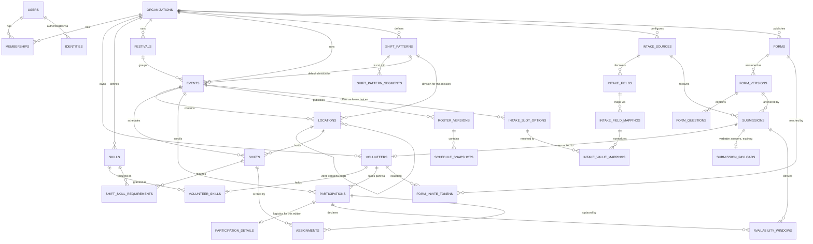

# 03 — Data model

PostgreSQL 17. All timestamps are `timestamptz` (stored UTC); all time ranges
are `tstzrange`. Primary keys are UUIDv7, generated by the application so that
a row's identity exists before it is written.

## 1. Entity relationships



### The three identity concepts

This trips people up, so it is stated once, explicitly:

- **`users`** — an organisation *member* who can authenticate: an owner,
  coordinator or zone lead. Global to the deployment, keyed by email. One user
  can belong to many organisations. **Volunteers are never users**
  ([ADR-0008](adr/0008-no-volunteer-authentication-in-v1.md)).
- **`volunteers`** — a person in one organisation's pool. Owned by that
  organisation. May have no email address at all. Has no account, no session
  and no login. Their data arrives through the intake pipeline (§3.10) or is
  typed in by a coordinator.
- **`participations`** — one volunteer's involvement in one event. Everything
  that varies per event — availability, T-shirt size for *this* edition,
  accreditation code, confirmation status — hangs off the participation, not
  the volunteer. The participation row itself is only the link and the status;
  the per-edition attributes are one table further out, on
  `participation_details` (§3.5), for the retention reason below.

Stable facts (name, phone, allergies) live on `volunteers`. Per-edition facts
live on `participation_details`. Getting this wrong is what makes spreadsheets
rot across editions.

`volunteers.user_id` exists but is always `NULL` in v1 — it is the attachment
point should volunteers ever be given accounts.

**This split also decides retention**, and that is why it is drawn where it is.
`volunteers` and `volunteer_skills` are pool-tier and survive with consent;
`participation_details`, `availability_windows` and the rest of the per-edition
data are event-tier and deleted 30 days after the event
([ADR-0021](adr/0021-retention-tier-follows-table.md),
[ADR-0026](adr/0026-retention-scope-is-a-table-registry.md)).

The tier is a property of the **table**, declared once in `retention_scope`
(§3.8), so the retention rule cannot drift from the schema and the sweep never
carries a list of columns. The practical consequence for anyone adding a field:
**putting a column on the wrong table is now a privacy bug, not a modelling
preference** — a per-edition attribute added to `volunteers` would survive for
eighteen months, and a stable one added to `participation_details` would be
deleted and re-asked. If a column ever needs to be nulled by the sweep rather
than deleted with its row, that is the signal it is on the wrong table.

## 2. Conventions

**Tenant integrity by composite foreign key.** Every tenant-owned table carries
`org_id`, and child tables reference their parent by `(parent_id, org_id)`
against a `UNIQUE (id, org_id)` on the parent. A row can therefore never point
at a row in another organisation — that is a foreign-key violation, not a
policy check. It costs one redundant column and one extra unique index per
table, and removes an entire bug class.

**Names: verbatim, plus parts that are asked.** `volunteers.display_name` is
stored exactly as given and never parsed. `first_name` and `last_name` are
optional and come from their own form questions — the form asks them separately
rather than anything splitting a combined field, because the real pool contains
mononyms, stage names, emoji and four-token names
([ADR-0012](adr/0012-name-parts-asked-not-parsed.md)). Greetings use
`coalesce(first_name, display_name)`.

**Soft delete only where history matters.** `assignments` and `participations`
use a status column and are never physically deleted, because roster diffs and
audit trails need them. Everything else is deleted for real.

**Optimistic concurrency.** Tables edited by more than one coordinator at once
(`events`, `shifts`, `assignments`, `locations`) carry `version int not null
default 1`, bumped by a trigger on update. Writes send `If-Match`.

## 3. Schema

Presented as the migration files would read. Where a table exists, its DDL
here tracks `migrations/`, which win on any difference; the tables below are specified but have **no
migration yet**, because the feature they serve is not built: `login_tokens`,
`invitations`, `skills`, `volunteer_skills`, `shift_skill_requirements`,
`participation_details`, `participation_missions`, `participation_answers`,
`roster_versions`, `schedule_snapshots`, `zone_lead_scopes`,
`org_retention_policies`, `org_rule_policies`, `calendar_feed_tokens`,
`outbox_messages`, `intake_fields`, `intake_field_mappings`,
`intake_slot_options`, `intake_value_mappings` and `form_invite_tokens`.

### 3.1 Extensions and enums

```sql
CREATE EXTENSION IF NOT EXISTS btree_gist;   -- uuid '=' inside GiST exclusion constraints
CREATE EXTENSION IF NOT EXISTS citext;       -- case-insensitive email
CREATE EXTENSION IF NOT EXISTS pg_trgm;      -- fuzzy name search in the volunteer pool
CREATE EXTENSION IF NOT EXISTS unaccent;     -- name normalisation

-- `unaccent()` is STABLE, not IMMUTABLE, because it depends on a dictionary,
-- so PostgreSQL rejects it in a generated column or an index expression. The
-- standard workaround is an immutable wrapper that names the dictionary
-- explicitly. It is safe precisely because the dictionary is pinned here.
CREATE FUNCTION immutable_unaccent(text) RETURNS text
  LANGUAGE sql IMMUTABLE STRICT PARALLEL SAFE AS
$$ SELECT public.unaccent('public.unaccent'::regdictionary, $1) $$;

-- No 'volunteer' role: volunteers do not authenticate (ADR-0008).
CREATE TYPE member_role         AS ENUM ('owner', 'coordinator', 'zone_lead');
CREATE TYPE event_status        AS ENUM ('draft', 'planning', 'published', 'running', 'archived');
CREATE TYPE participation_status AS ENUM ('invited', 'confirmed', 'declined', 'withdrawn');
CREATE TYPE assignment_status   AS ENUM ('draft', 'published', 'cancelled');
CREATE TYPE availability_kind   AS ENUM ('available', 'unavailable');
CREATE TYPE location_kind       AS ENUM ('zone', 'post');

-- How a shift pattern covers the window it is applied to (ADR-0029).
--   'tile' — repeat the segment list until the window is full: the 2 h default
--   'once' — lay the list exactly once from the window start: the artiste case
CREATE TYPE pattern_repeat      AS ENUM ('tile', 'once');
-- A segment either produces a shift or is dead time between two: a changeover,
-- a meal, a sound check. Both consume window time; only 'shift' creates a row.
CREATE TYPE pattern_segment_kind AS ENUM ('shift', 'gap');

CREATE TYPE intake_source_kind  AS ENUM ('csv_upload', 'google_sheet', 'webhook', 'api', 'internal_form');
CREATE TYPE intake_target_kind  AS ENUM ('identity', 'volunteer_field', 'participation_field',
                                         'skill', 'availability', 'reserved', 'ignore');
CREATE TYPE submission_state    AS ENUM ('received', 'needs_review', 'applied', 'rejected', 'superseded');
-- 'token': arrived through a per-volunteer form link, so identity is certain
CREATE TYPE match_kind          AS ENUM ('token', 'exact_email', 'fuzzy_confirmed', 'manual', 'new');

-- Eleven question types, plus 'section', which is layout and takes no answer
-- (09 §1). 'missions' is ADR-0036. A form builder stops here deliberately: no
-- branching, no page logic.
CREATE TYPE form_question_kind  AS ENUM ('short_text', 'email', 'phone', 'date',
                                         'single_choice', 'multi_choice', 'boolean',
                                         'long_text', 'availability', 'missions',
                                         'consent', 'section');

-- What a consent answer is consent *for*. Two purposes, two lawful bases, two
-- retention consequences, and only the first may be required (ADR-0025).
CREATE TYPE consent_purpose     AS ENUM ('processing', 'pool_retention', 'commitment');
```

Native enums are used for sets that are part of the domain and change rarely.
Adding a value is `ALTER TYPE ... ADD VALUE` (non-blocking since PG 12);
removing one requires a migration either way.

### 3.2 Tenancy and identity

```sql
CREATE TABLE organizations (
  id          uuid PRIMARY KEY,
  slug        citext NOT NULL UNIQUE,
  name        text   NOT NULL,
  timezone    text   NOT NULL DEFAULT 'Europe/Paris',   -- default for new events
  created_at  timestamptz NOT NULL DEFAULT now(),
  CONSTRAINT organizations_slug_format CHECK (slug ~ '^[a-z0-9][a-z0-9-]{1,38}[a-z0-9]$')
);

CREATE TABLE users (
  id            uuid PRIMARY KEY,
  email         citext NOT NULL UNIQUE,
  display_name  text   NOT NULL,
  locale        text   NOT NULL DEFAULT 'fr',
  avatar_url    text,                    -- from the OIDC `picture` claim, if given
  created_at    timestamptz NOT NULL DEFAULT now(),
  last_login_at timestamptz
);

-- How a user proves who they are. One user may have several: an emailed magic
-- link (always available), plus any OIDC provider the deployment configured
-- (ADR-0014).
CREATE TABLE identities (
  id            uuid PRIMARY KEY,
  user_id       uuid NOT NULL REFERENCES users(id) ON DELETE CASCADE,
  -- The `id` of a provider declared in providers.toml, or 'email' for magic
  -- links. IMMUTABLE once used: renaming a provider orphans its identities,
  -- so startup checks configured ids against the distinct values here.
  provider      text NOT NULL,
  -- The provider's stable subject, per its configured claim map — usually the
  -- `sub` claim, NOT the address: emails change, `sub` does not. Some providers
  -- prefer another claim (Entra's `oid`), hence the mapping. For 'email' it is
  -- the address itself.
  subject       text NOT NULL,
  -- The address as asserted at link time, kept for audit. Never used to match.
  email_at_link citext,
  linked_at     timestamptz NOT NULL DEFAULT now(),
  last_used_at  timestamptz,
  UNIQUE (provider, subject),
  UNIQUE (user_id, provider)             -- one account per provider per user
);
CREATE INDEX ON identities (user_id);

CREATE TABLE memberships (
  id         uuid PRIMARY KEY,
  org_id     uuid NOT NULL REFERENCES organizations(id) ON DELETE CASCADE,
  user_id    uuid NOT NULL REFERENCES users(id) ON DELETE CASCADE,
  role       member_role NOT NULL,
  created_at timestamptz NOT NULL DEFAULT now(),
  UNIQUE (org_id, user_id)
);
CREATE INDEX ON memberships (user_id);
```

Authentication artefacts — deliberately boring, all server-side:

```sql
CREATE TABLE login_tokens (
  id          uuid PRIMARY KEY,
  email       citext NOT NULL,
  token_hash  bytea  NOT NULL UNIQUE,        -- SHA-256 of the emailed secret
  expires_at  timestamptz NOT NULL,
  consumed_at timestamptz,
  request_ip  inet,
  created_at  timestamptz NOT NULL DEFAULT now()
);
CREATE INDEX ON login_tokens (email, created_at DESC);

CREATE TABLE sessions (
  id            uuid PRIMARY KEY,
  user_id       uuid NOT NULL REFERENCES users(id) ON DELETE CASCADE,
  token_hash    bytea NOT NULL UNIQUE,       -- SHA-256 of the cookie value
  issued_at     timestamptz NOT NULL DEFAULT now(),
  last_seen_at  timestamptz NOT NULL DEFAULT now(),
  absolute_expiry timestamptz NOT NULL,
  revoked_at    timestamptz,
  user_agent    text,
  ip            inet
);
CREATE INDEX ON sessions (user_id) WHERE revoked_at IS NULL;

CREATE TABLE invitations (
  id          uuid PRIMARY KEY,
  org_id      uuid NOT NULL REFERENCES organizations(id) ON DELETE CASCADE,
  email       citext NOT NULL,
  role        member_role NOT NULL,
  token_hash  bytea NOT NULL UNIQUE,
  invited_by  uuid NOT NULL REFERENCES users(id),
  expires_at  timestamptz NOT NULL,
  accepted_at timestamptz,
  revoked_at  timestamptz
);
-- at most one *pending* invite per address; re-inviting a former member is fine
CREATE UNIQUE INDEX invitations_one_pending ON invitations (org_id, email)
  WHERE accepted_at IS NULL AND revoked_at IS NULL;
```

Only hashes of secrets are stored. A database dump therefore cannot be used to
log in as anybody.

Both tables are `ephemeral` in `retention_scope` (§3.8): a consumed or expired
`login_tokens` row and a revoked or expired `sessions` row have no purpose left,
and each holds an IP address and a user agent. The daily sweep deletes them.
Nothing was deleting them before the registry required every table to declare a
tier, which is the kind of omission the registry exists to surface.

**No provider tokens are stored at all.** Google's ID token is verified at
login and discarded, and `offline_access` is never requested, so there is no
refresh token to leak ([ADR-0013](adr/0013-google-oidc-without-an-identity-provider.md)).
`sessions` remains the only bearer of authenticated state, which is what keeps
revocation immediate.

Account linking is the one security-relevant join here, and it depends on
whether the deployment trusts the provider
([ADR-0014](adr/0014-pluggable-oidc-providers.md)):

- A provider configured `trust_email_verified = true` may be attached to an
  existing `users` row automatically, when it asserts `email_verified` **and**
  the address matches. Both paths then prove control of the address — magic
  link by delivery, the provider by assertion — so the match is sound.
- A provider *not* so configured — the default — never links by address. It
  creates a distinct user, and attaching it requires being signed in through a
  trusted method first. Otherwise any IdP that lets a user type an arbitrary
  unverified address could claim someone else's account.
- A missing `email_verified` claim counts as `false`, never as "probably fine".

Every link is written to `audit_log`.

### 3.3 The volunteer pool

```sql
CREATE TABLE volunteers (
  id            uuid PRIMARY KEY,
  org_id        uuid NOT NULL REFERENCES organizations(id) ON DELETE CASCADE,
  -- Reserved. Volunteers do not authenticate in v1 (ADR-0008); this is the
  -- attachment point if that is ever revisited. Always NULL for now.
  user_id       uuid REFERENCES users(id) ON DELETE SET NULL,
  -- The roster label, stored exactly as given, never parsed. Required.
  -- The pool contains mononyms, stage names, emoji and 4-token names: ADR-0012.
  display_name  text NOT NULL,
  -- generated, for search and fuzzy matching only — never displayed, never an identity
  display_name_norm text NOT NULL
    GENERATED ALWAYS AS (
      lower(regexp_replace(immutable_unaccent(display_name), '\s+', ' ', 'g'))
    ) STORED,
  sort_name     text,          -- optional, so 'SURNAME Firstname' can sort sensibly
  -- Name parts are ASKED by the form as separate questions, never derived by
  -- splitting display_name (ADR-0012). NULL for the legacy CSV import.
  first_name    text,          -- what we greet them by
  last_name     text,          -- disambiguates two volunteers sharing a first name,
                               -- and corroborates a fuzzy match during reconciliation
  email         citext,
  phone         text,
  tshirt_size   text CHECK (tshirt_size IN ('XS','S','M','L','XL','XXL','3XL')),
  -- Special-category-adjacent: free text that may reveal religion or health,
  -- so retaining it needs *explicit* consent (ADR-0021). Coordinators only,
  -- excluded from default exports.
  dietary       text,
  notes         text,          -- standing notes. VISIBLE to the volunteer in their export
  is_active     boolean NOT NULL DEFAULT true,
  -- Columns a coordinator has edited by hand. Intake never overwrites these.
  locked_fields text[] NOT NULL DEFAULT '{}',
  -- Per-channel opt-out, adopted from the spreadsheet's isEmailDisabled /
  -- isSmsDisabled flags. Respected by the publish worker.
  notify_email  boolean NOT NULL DEFAULT true,
  notify_sms    boolean NOT NULL DEFAULT true,
  locale        text NOT NULL DEFAULT 'fr',   -- emails, SMS and PDF are rendered in this
  -- Pool retention consent (ADR-0018). NULL means event-scoped only: this
  -- record is anonymised one month after the event, like everything else.
  pool_consent_at      timestamptz,
  pool_consent_version text,
  pool_consent_expires timestamptz,           -- last contact + org policy, recomputed on contact
  is_core_team         boolean NOT NULL DEFAULT false,  -- coordinator marker, not a consent gate
  anonymized_at timestamptz,   -- GDPR erasure: PII nulled, row kept for audit integrity
  created_at    timestamptz NOT NULL DEFAULT now(),
  updated_at    timestamptz NOT NULL DEFAULT now(),
  version       int NOT NULL DEFAULT 1,
  UNIQUE (id, org_id),                                  -- anchor for composite FKs
  -- An address identifies at most one volunteer in an organisation (ADR-0028).
  -- It is the corroborating identity on the public route, the delivery address
  -- for both capability links, and the second proof for erasure — it cannot be
  -- shared. NULL is permitted any number of times: a volunteer with no email
  -- is supported, and is maintained by a coordinator.
  CONSTRAINT volunteers_email_unique_per_org UNIQUE (org_id, email)
);
CREATE INDEX ON volunteers (org_id) WHERE is_active;
CREATE INDEX volunteers_name_trgm ON volunteers
  USING gin (display_name_norm gin_trgm_ops);   -- pool search + fuzzy reconciliation
-- "who else in this org shares this first name?" — drives surname disambiguation
CREATE INDEX volunteers_first_name ON volunteers (org_id, lower(first_name))
  WHERE first_name IS NOT NULL;

CREATE TABLE skills (
  id          uuid PRIMARY KEY,
  org_id      uuid NOT NULL REFERENCES organizations(id) ON DELETE CASCADE,
  code        citext NOT NULL,          -- 'first_aid', 'bar', 'forklift'
  label       text NOT NULL,
  description text,
  UNIQUE (org_id, code),
  UNIQUE (id, org_id)
);

CREATE TABLE volunteer_skills (
  volunteer_id uuid NOT NULL,
  skill_id     uuid NOT NULL,
  org_id       uuid NOT NULL,
  level        smallint NOT NULL DEFAULT 1 CHECK (level BETWEEN 1 AND 5),
  valid_from   date,
  valid_until  date,                    -- certificates lapse; NULL = no expiry
  note         text,
  PRIMARY KEY (volunteer_id, skill_id),
  FOREIGN KEY (volunteer_id, org_id) REFERENCES volunteers(id, org_id) ON DELETE CASCADE,
  FOREIGN KEY (skill_id, org_id)     REFERENCES skills(id, org_id)     ON DELETE CASCADE,
  CONSTRAINT volunteer_skills_valid_range CHECK (valid_until IS NULL OR valid_from IS NULL OR valid_until >= valid_from)
);
CREATE INDEX ON volunteer_skills (skill_id);
```

`valid_until` is what makes "is this person still first-aid qualified *on the
day of the shift*" answerable, rather than "were they ever".

### 3.4 Events, locations, shifts

A timezone must be a real IANA name. That cannot be a `CHECK` constraint —
`CHECK` expressions must be immutable and cannot contain subqueries, which
rules out both `now() AT TIME ZONE tz` and a lookup in `pg_timezone_names`. A
foreign key to a small snapshot table is the honest way to express it:

```sql
CREATE TABLE timezones (name text PRIMARY KEY);
INSERT INTO timezones SELECT name FROM pg_timezone_names;   -- refreshed by migration on tzdata bumps
```

**Festivals group events** (ADR-0032). A festival is a production spanning
several events that a coordinator plans and staffs as one whole — Soundclash
26 is one festival containing an Open Air day, two club nights, an after, and
its own montage/démontage days, each with its own period and its own
locations:

```sql
CREATE TABLE festivals (
  id         uuid PRIMARY KEY,
  org_id     uuid NOT NULL REFERENCES organizations(id) ON DELETE CASCADE,
  name       text NOT NULL,
  slug       citext NOT NULL,
  timezone   text NOT NULL,
  period     tstzrange NOT NULL,       -- the outer window a coordinator plans against
  status     event_status NOT NULL DEFAULT 'draft',   -- shared vocabulary with events.status
  created_at timestamptz NOT NULL DEFAULT now(),
  updated_at timestamptz NOT NULL DEFAULT now(),
  version    int NOT NULL DEFAULT 1,
  UNIQUE (org_id, slug),
  UNIQUE (id, org_id),                                -- anchor for events.festival_id
  CONSTRAINT festivals_period_valid CHECK (NOT isempty(period) AND lower(period) IS NOT NULL AND upper(period) IS NOT NULL),
  CONSTRAINT festivals_timezone_known FOREIGN KEY (timezone) REFERENCES timezones(name)
);
```

A festival has no locations or shifts of its own — those stay on `events`,
because "Soundclash 26's Bar" is really "Open Air's Bar" and "Dub & 2step's
Bar" independently staffed (ADR-0032 explains why grouping is a separate
table rather than a bigger event or a third `locations` level).
`events.festival_id` below is **nullable**: a standalone one-day event is not
required to belong to one, and `POST …/events` omits the key entirely to mean
that (docs/04).

**Shift patterns come first**, because `events` and `locations` both reference
one. A pattern describes how a working window is cut into slots: most missions
are 2 hours, and *artiste* is `45 / 45 / 90 / 45 / 45`. It is owned by the
**organisation**, not by an event, so the division survives from one edition to
the next — the reuse is the point ([ADR-0029](adr/0029-shift-patterns-are-generators-not-constraints.md)).

```sql
CREATE TABLE shift_patterns (
  id         uuid PRIMARY KEY,
  org_id     uuid NOT NULL REFERENCES organizations(id) ON DELETE CASCADE,
  name       text NOT NULL,                 -- 'Créneaux 2 h', 'Artiste'
  repeat     pattern_repeat NOT NULL DEFAULT 'tile',
  -- What to do with the time left when a 'tile' pattern does not divide the
  -- window: drop it (the default), or emit a shorter final shift. Never
  -- silently round — a half slot nobody asked for is worse than a visible gap.
  on_remainder text NOT NULL DEFAULT 'drop'
    CHECK (on_remainder IN ('drop', 'truncate')),
  is_archived boolean NOT NULL DEFAULT false,
  created_at timestamptz NOT NULL DEFAULT now(),
  updated_at timestamptz NOT NULL DEFAULT now(),
  version    int NOT NULL DEFAULT 1,
  UNIQUE (org_id, name),
  UNIQUE (id, org_id)
);

CREATE TABLE shift_pattern_segments (
  pattern_id       uuid NOT NULL,
  org_id           uuid NOT NULL,
  position         smallint NOT NULL CHECK (position >= 0),
  kind             pattern_segment_kind NOT NULL DEFAULT 'shift',
  -- Minutes, because that is what a coordinator types. The 24-hour ceiling
  -- matches shifts_period_sane; the 5-minute floor is there so a typo of 0
  -- cannot produce an infinite tiling loop in the generator.
  duration_minutes int NOT NULL CHECK (duration_minutes BETWEEN 5 AND 1440),
  label            text,                    -- 'Balances', 'Set', optional
  PRIMARY KEY (pattern_id, position),
  FOREIGN KEY (pattern_id, org_id) REFERENCES shift_patterns(id, org_id) ON DELETE CASCADE
);
```

A pattern with no `shift` segment, or with holes in its ordering, generates
either nothing or the wrong thing. Both are rejected — but the check cannot be
`INITIALLY IMMEDIATE` like the others in this schema, because the pattern row is
necessarily inserted before its segments:

```sql
CREATE FUNCTION shift_pattern_is_well_formed() RETURNS trigger AS $$
DECLARE pid uuid; n int; shifts int; top int;
BEGIN
  -- NEW is unassigned on DELETE; reading it there is an error, not a NULL.
  IF TG_OP = 'DELETE' THEN pid := OLD.pattern_id; ELSE pid := NEW.pattern_id; END IF;

  -- Deleting the pattern cascades to its segments and fires this trigger with
  -- nothing left to judge. Without this guard, no pattern could ever be
  -- deleted: the check would see zero segments and refuse the delete.
  PERFORM 1 FROM shift_patterns WHERE id = pid;
  IF NOT FOUND THEN RETURN NULL; END IF;

  SELECT count(*), count(*) FILTER (WHERE kind = 'shift'), coalesce(max(position), -1)
    INTO n, shifts, top
    FROM shift_pattern_segments WHERE pattern_id = pid;
  IF shifts = 0 THEN
    RAISE EXCEPTION 'shift pattern % has no shift segment', pid
      USING ERRCODE = 'check_violation', CONSTRAINT = 'pattern_empty';
  END IF;
  IF top <> n - 1 THEN
    RAISE EXCEPTION 'shift pattern % has gaps in its segment ordering', pid
      USING ERRCODE = 'check_violation', CONSTRAINT = 'pattern_positions_contiguous';
  END IF;
  RETURN NULL;
END $$ LANGUAGE plpgsql;

CREATE CONSTRAINT TRIGGER shift_pattern_segments_well_formed
  AFTER INSERT OR UPDATE OR DELETE ON shift_pattern_segments
  DEFERRABLE INITIALLY DEFERRED
  FOR EACH ROW EXECUTE FUNCTION shift_pattern_is_well_formed();
```

`INITIALLY DEFERRED`, so the whole pattern is judged at `COMMIT` rather than
row by row — inserting the pattern, then five segments, then committing is the
normal path and must not fail halfway through it. Emptying an existing pattern
is refused, because the `DELETE` of its last segment fires the same trigger.

There is deliberately **no** trigger on `shift_patterns`, which leaves exactly
one hole: a pattern created with no segments at all is never judged. That row is
inert — it generates nothing, and the generator refuses it with a `422` naming
it — and the alternative, a deferred trigger on the parent, would fire on every
rename to re-check segments that did not change.

```sql
CREATE TABLE events (
  id           uuid PRIMARY KEY,
  org_id       uuid NOT NULL REFERENCES organizations(id) ON DELETE CASCADE,
  festival_id  uuid,                             -- NULL: a standalone event (ADR-0032)
  name         text NOT NULL,
  slug         citext NOT NULL,
  timezone     text NOT NULL,                    -- IANA, e.g. 'Europe/Paris'
  -- The *operational* window: everything this edition covers, including the
  -- hours worked before the doors open and after they close. It is what every
  -- shift is bounded by, and therefore what grows when work is scheduled past
  -- its edge (ADR-0044).
  period       tstzrange NOT NULL,
  -- When the doors are open, if that has been decided. Set and cleared by a
  -- coordinator; NULL means no public hours have been stated, never "same as
  -- period". Not derived from `period`: the bar staff arriving early do not
  -- move the doors (ADR-0044, superseding ADR-0033's first-growth rule;
  -- migration 20260917120000).
  public_period tstzrange,
  status       event_status NOT NULL DEFAULT 'draft',
  -- Index into the 64-colour event palette (packages/shared/src/eventColors.ts),
  -- assigned on insert from the indices this event's siblings are not using.
  color        smallint NOT NULL CHECK (color >= 0 AND color < 64),
  duplicated_from uuid REFERENCES events(id) ON DELETE SET NULL,

  -- scheduling policy, used by the soft-constraint engine
  max_hours_per_day       numeric(4,2) NOT NULL DEFAULT 10,
  min_rest_minutes        int          NOT NULL DEFAULT 480,
  max_consecutive_days    int          NOT NULL DEFAULT 5,
  -- night window for the minor_night_shift rule (ADR-0023). Local wall-clock
  -- times in this event's timezone, not instants: the window means 22:00 on
  -- every day of the event, including one that is 23 hours long (16 §3).
  -- It wraps midnight by design, so no CHECK that start < end.
  night_starts_at         time         NOT NULL DEFAULT '22:00',
  night_ends_at           time         NOT NULL DEFAULT '06:00',
  -- granularity of the form's availability picker, in minutes. It must divide
  -- every segment of every pattern used in this event, or volunteers cannot
  -- declare availability against the shifts it generates (ADR-0029). Checked
  -- when a pattern is attached, not here: it spans rows.
  availability_step_minutes int        NOT NULL DEFAULT 30
    CHECK (availability_step_minutes IN (15, 30, 60)),
  -- How this event's days are cut into slots unless a location says otherwise.
  -- NULL means the organisation's 2 h default, seeded with the org.
  default_shift_pattern_id uuid,

  created_at   timestamptz NOT NULL DEFAULT now(),
  updated_at   timestamptz NOT NULL DEFAULT now(),
  version      int NOT NULL DEFAULT 1,
  UNIQUE (org_id, slug),
  UNIQUE (id, org_id),
  CONSTRAINT events_period_valid CHECK (NOT isempty(period) AND lower(period) IS NOT NULL AND upper(period) IS NOT NULL),
  -- Containment is expressible as a CHECK because both bounds are on this
  -- row, unlike the shift-inside-event rule below. It also closes the other
  -- direction: a period shrunk back inside the published hours is refused.
  CONSTRAINT events_public_period_valid CHECK (
    public_period IS NULL OR (
      NOT isempty(public_period)
      AND lower(public_period) IS NOT NULL
      AND upper(public_period) IS NOT NULL
      AND public_period <@ period
    )
  ),
  CONSTRAINT events_timezone_known FOREIGN KEY (timezone) REFERENCES timezones(name),
  -- SET NULL naming its column: the composite key includes org_id, which is
  -- NOT NULL, so a bare SET NULL would try to null it too and fail at delete
  -- time. The column list form is PostgreSQL 15+.
  FOREIGN KEY (festival_id, org_id)
    REFERENCES festivals(id, org_id) ON DELETE SET NULL (festival_id),
  FOREIGN KEY (default_shift_pattern_id, org_id)
    REFERENCES shift_patterns(id, org_id) ON DELETE SET NULL (default_shift_pattern_id)
);

CREATE TABLE locations (
  id         uuid PRIMARY KEY,
  org_id     uuid NOT NULL,
  event_id   uuid NOT NULL,
  parent_id  uuid,                                  -- posts point at their zone
  kind       location_kind NOT NULL,
  name       text NOT NULL,
  -- What the job is, and where to stand: the two things a volunteer has to be
  -- told before they can work the post, and the two the Google Sheet kept in a
  -- free-text column beside each poste. Both NULL when nobody has said, never
  -- '' — a CHECK on each refuses a blank string, so "nothing said" has one
  -- spelling. `address` is prose, not a postal record: it is what you would say
  -- to somebody who is lost.
  description text,
  address     text,
  -- A postal address a map or courier can resolve, distinct from `address`
  -- above (wayfinding prose for someone already on site). Zones only — a post
  -- is reached through its own zone, so it carries no map data of its own.
  exact_address text,
  -- Decimal degrees, WGS 84, set together or not at all. For a site with no
  -- postal address to give — open ground during build/strike — a pin is the
  -- only thing there is.
  latitude   double precision,
  longitude  double precision,
  -- How many volunteers the mission takes: the fewest it should be staffed
  -- with and the most it may hold. Each NULL when nobody has said — neither
  -- zero nor "unbounded". Zones and posts alike, and a zone's bounds are its
  -- own statement, never a sum over its posts. The shift-level
  -- required_count/max_count below stay the per-slot numbers; these are the
  -- mission's standing answer.
  min_volunteers smallint CHECK (min_volunteers >= 0),
  max_volunteers smallint CHECK (max_volunteers >= 1),
  -- How the volunteer form's missions question offers this zone (ADR-0041):
  -- already ticked, or waiting for an explicit tick (a technical mission);
  -- and whether it is for volunteers aged 18 or over (shown, never enforced,
  -- never pre-ticked). Zones only: a post holds the neutral values and takes
  -- its zone's.
  checked_by_default boolean NOT NULL DEFAULT true,
  adults_only        boolean NOT NULL DEFAULT false,
  sort_order int NOT NULL DEFAULT 0,
  colour     text,                                  -- board rendering
  -- This mission's own slot division, where it differs from the event's.
  -- NULL — the common case — inherits events.default_shift_pattern_id.
  -- This is the column that makes "artiste is 45/45/90/45/45" one row rather
  -- than a special case in the generator (ADR-0029).
  shift_pattern_id uuid,
  version    int NOT NULL DEFAULT 1,
  UNIQUE (id, org_id),
  UNIQUE (event_id, parent_id, name),
  FOREIGN KEY (event_id, org_id)  REFERENCES events(id, org_id)   ON DELETE CASCADE,
  FOREIGN KEY (parent_id, org_id) REFERENCES locations(id, org_id) ON DELETE CASCADE,
  FOREIGN KEY (shift_pattern_id, org_id)
    REFERENCES shift_patterns(id, org_id) ON DELETE SET NULL (shift_pattern_id),
  CONSTRAINT locations_hierarchy CHECK (
    (kind = 'zone' AND parent_id IS NULL) OR (kind = 'post' AND parent_id IS NOT NULL)
  ),
  CONSTRAINT locations_description_not_blank CHECK (description IS NULL OR btrim(description) <> ''),
  CONSTRAINT locations_address_not_blank     CHECK (address IS NULL OR btrim(address) <> ''),
  CONSTRAINT locations_exact_address_not_blank CHECK (exact_address IS NULL OR btrim(exact_address) <> ''),
  CONSTRAINT locations_latitude_in_range  CHECK (latitude BETWEEN -90 AND 90),
  CONSTRAINT locations_longitude_in_range CHECK (longitude BETWEEN -180 AND 180),
  CONSTRAINT locations_latitude_longitude_together CHECK ((latitude IS NULL) = (longitude IS NULL)),
  CONSTRAINT locations_posts_have_no_map_data CHECK (
    kind = 'zone' OR (exact_address IS NULL AND latitude IS NULL AND longitude IS NULL)
  ),
  CONSTRAINT locations_volunteer_bounds_ordered CHECK (
    min_volunteers IS NULL OR max_volunteers IS NULL OR max_volunteers >= min_volunteers
  ),
  CONSTRAINT locations_posts_have_no_form_flags CHECK (
    kind = 'zone' OR (checked_by_default AND NOT adults_only)
  )
);
CREATE INDEX ON locations (event_id, sort_order);
```

`description` and `address` are per **event**, like everything else on this
table, and that is deliberate rather than a missed normalisation: Open Air's
bar is behind the main stage and the club's bar is in the club, so these are
precisely the columns the days of a festival genuinely disagree about. The
admin app folds the rows back into one mission by name and writes the same
value to each when a coordinator asks it to — an affordance in the client
(`apps/admin/src/plan/missionCatalog.ts`), never a claim in the schema that
four posts are one. `exact_address`/`latitude`/`longitude` and
`min_volunteers`/`max_volunteers` follow the same per-event rule, for the same
reason — the Saturday bar needs more hands than the Thursday one. So do
`checked_by_default`/`adults_only`. When the days disagree, the form's folded
option takes the stricter answer (ADR-0041).

The volunteer bounds refuse only what is incoherent: a negative floor, a
ceiling of zero (a mission nobody may staff is one to delete), and a ceiling
below the floor. Whether a roster actually *meets* them is soft-warning
territory for `evp-domain`, overridable by a coordinator, and never a schema
rule ([ADR-0007](adr/0007-hard-vs-soft-scheduling-constraints.md)).

The hierarchy is intentionally exactly two levels, enforced by a `CHECK`. An
arbitrary-depth tree would be more general and would make the board layout,
the coverage rollup and the zone-lead permission scope all materially harder.
Two levels matches how the events are actually organised.

```sql
CREATE TABLE shifts (
  id             uuid PRIMARY KEY,
  org_id         uuid NOT NULL,
  event_id       uuid NOT NULL,
  location_id    uuid NOT NULL,
  title          text,                              -- NULL: inherit the location name
  period         tstzrange NOT NULL,
  required_count smallint NOT NULL DEFAULT 1 CHECK (required_count >= 0),
  max_count      smallint CHECK (max_count IS NULL OR max_count >= required_count),
  notes          text,
  created_at     timestamptz NOT NULL DEFAULT now(),
  updated_at     timestamptz NOT NULL DEFAULT now(),
  version        int NOT NULL DEFAULT 1,
  UNIQUE (id, org_id),
  FOREIGN KEY (event_id, org_id)    REFERENCES events(id, org_id)    ON DELETE CASCADE,
  FOREIGN KEY (location_id, org_id) REFERENCES locations(id, org_id) ON DELETE CASCADE,
  CONSTRAINT shifts_period_valid CHECK (
    NOT isempty(period) AND lower(period) IS NOT NULL AND upper(period) IS NOT NULL
  ),
  CONSTRAINT shifts_period_sane CHECK (upper(period) - lower(period) <= interval '24 hours')
);
CREATE INDEX shifts_event_period ON shifts USING gist (event_id, period);
CREATE INDEX ON shifts (location_id);

CREATE TABLE shift_skill_requirements (
  shift_id  uuid NOT NULL,
  skill_id  uuid NOT NULL,
  org_id    uuid NOT NULL,
  min_count smallint NOT NULL DEFAULT 1 CHECK (min_count >= 1),
  PRIMARY KEY (shift_id, skill_id),
  FOREIGN KEY (shift_id, org_id) REFERENCES shifts(id, org_id) ON DELETE CASCADE,
  FOREIGN KEY (skill_id, org_id) REFERENCES skills(id, org_id) ON DELETE CASCADE
);
```

`shifts_event_period` is a GiST index on `(event_id, period)` — this is what
makes "all shifts overlapping this window" and the coverage query fast without
scanning the event.

**There is no `source_pattern_id` on `shifts`, and that is the decision, not an
omission.** A pattern is a generator: it produces rows and then has nothing
further to do with them ([ADR-0029](adr/0029-shift-patterns-are-generators-not-constraints.md)).
A shift's period is bounded by the two `CHECK`s above and by nothing else, so a
coordinator moving a generated 45-minute slot to 10:20 is doing something
ordinary rather than breaking an alignment. Recording the provenance would
invite the feature behind it — regenerate, re-sync, "the pattern changed, update
240 shifts?" — which is the constraint this ADR refuses, arriving by a side
door. Undoing a generation is served instead by `operations`
([ADR-0024](adr/0024-server-side-undo-and-per-item-bulk.md)): one generation is
one operation with one inverse.

**HARD INVARIANT: a shift cannot fall outside its event.** This is one of the
six ([05 §2](05-scheduling-rules.md#2-hard-rules)) and it cannot be a `CHECK`,
because the bound it compares against lives on another row. It is a constraint
trigger in both directions, so neither moving the shift nor shrinking the event
can produce a shift outside its event:

```sql
CREATE FUNCTION shifts_within_event() RETURNS trigger AS $$
DECLARE ev tstzrange;
BEGIN
  SELECT e.period INTO ev FROM events e WHERE e.id = NEW.event_id;
  IF NOT (NEW.period <@ ev) THEN
    RAISE EXCEPTION 'shift period % is outside event period %', NEW.period, ev
      USING ERRCODE = 'check_violation', CONSTRAINT = 'shift_outside_event';
  END IF;
  RETURN NEW;
END $$ LANGUAGE plpgsql;

CREATE CONSTRAINT TRIGGER shifts_within_event_check
  AFTER INSERT OR UPDATE OF period, event_id ON shifts
  DEFERRABLE INITIALLY IMMEDIATE
  FOR EACH ROW EXECUTE FUNCTION shifts_within_event();

-- the other direction: an event's period may not shrink away from its shifts
CREATE FUNCTION events_period_covers_shifts() RETURNS trigger AS $$
DECLARE stray int;
BEGIN
  SELECT count(*) INTO stray FROM shifts s
   WHERE s.event_id = NEW.id AND NOT (s.period <@ NEW.period);
  IF stray > 0 THEN
    RAISE EXCEPTION '% shift(s) would fall outside the new event period', stray
      USING ERRCODE = 'check_violation', CONSTRAINT = 'shift_outside_event';
  END IF;
  RETURN NEW;
END $$ LANGUAGE plpgsql;

CREATE CONSTRAINT TRIGGER events_period_covers_shifts_check
  AFTER UPDATE OF period ON events
  DEFERRABLE INITIALLY IMMEDIATE
  FOR EACH ROW EXECUTE FUNCTION events_period_covers_shifts();
```

A `CONSTRAINT TRIGGER` rather than a plain one, and `AFTER` rather than
`BEFORE`, so that bulk shift creation and an event resize inside one
transaction see each other's rows — a `BEFORE` trigger would reject a legitimate
"widen the event, then add the shifts" ordering. Both raise `23514` with a named
constraint, so the API maps them to the `shift_outside_event` violation like any
other.

### 3.5 Participation and availability

`participations` is the **join** between a volunteer and an event: assignments
and roster versions hang off it, so the row has to survive the retention sweep.
Everything per-edition and personal therefore lives one table further out, in
`participation_details`, which the sweep deletes outright
([ADR-0026](adr/0026-retention-scope-is-a-table-registry.md)). One table, one
tier: that is what makes "tier follows table" derivable rather than aspirational.

```sql
-- Skeleton. Identifiers, the link, the status, timestamps. Nothing personal
-- beyond the fact that this person volunteered, which the roster records anyway.
-- Tier: accountability — retained, pseudonymous once the volunteer is anonymised.
CREATE TABLE participations (
  id                uuid PRIMARY KEY,
  org_id            uuid NOT NULL,
  event_id          uuid NOT NULL,
  volunteer_id      uuid NOT NULL,
  status            participation_status NOT NULL DEFAULT 'invited',

  created_at        timestamptz NOT NULL DEFAULT now(),
  updated_at        timestamptz NOT NULL DEFAULT now(),
  UNIQUE (event_id, volunteer_id),
  UNIQUE (id, volunteer_id),                    -- anchor for the assignment composite FK
  UNIQUE (id, event_id),                        -- anchor for the details composite FK
  UNIQUE (id, org_id),
  FOREIGN KEY (event_id, org_id)     REFERENCES events(id, org_id)     ON DELETE CASCADE,
  FOREIGN KEY (volunteer_id, org_id) REFERENCES volunteers(id, org_id) ON DELETE CASCADE
);
CREATE INDEX ON participations (event_id, status);

-- Per-edition logistics and declarations. Event-tier in full: the sweep deletes
-- these rows `event_data_days` after the event ends, regardless of pool consent
-- (ADR-0026). A new per-edition column added here is purged automatically,
-- which is the whole reason the table exists.
CREATE TABLE participation_details (
  participation_id  uuid PRIMARY KEY,
  org_id            uuid NOT NULL,
  event_id          uuid NOT NULL,              -- denormalised, for the accreditation unique
  -- Per-event override only; volunteers.tshirt_size holds the stable value.
  tshirt_size       text CHECK (tshirt_size IN ('XS','S','M','L','XL','XXL','3XL')),
  -- Which catering option AT THIS EVENT. The stable dietary requirement lives
  -- on volunteers.dietary; this is a per-edition choice.
  meal_plan         text,
  accreditation_code text,
  -- «J'ai 18 ans ou plus», as declared by the volunteer for THIS edition
  -- (ADR-0023). Input to the minor_night_shift soft rule.
  --   NULL  = not asked, or asked and not answered -> unknown, does not warn
  --   false = declared under 18                    -> warns on night shifts
  -- Deliberately not a birthdate (ADR-0022), and deliberately here: it is
  -- purged with the edition and re-asked next time rather than quietly ageing
  -- out of correctness.
  -- A self-declaration. Nobody verifies it; it is not evidence of compliance.
  is_adult          boolean,
  arrival_at        timestamptz,
  departure_at      timestamptz,
  notes             text,
  updated_at        timestamptz NOT NULL DEFAULT now(),
  FOREIGN KEY (participation_id, event_id)
    REFERENCES participations(id, event_id) ON DELETE CASCADE,
  FOREIGN KEY (participation_id, org_id)
    REFERENCES participations(id, org_id)   ON DELETE CASCADE,
  CONSTRAINT participation_accreditation_unique UNIQUE (event_id, accreditation_code),
  CONSTRAINT participation_stay_order CHECK (
    arrival_at IS NULL OR departure_at IS NULL OR departure_at > arrival_at
  )
);

CREATE TABLE availability_windows (
  id               uuid PRIMARY KEY,
  org_id           uuid NOT NULL,
  participation_id uuid NOT NULL,
  kind             availability_kind NOT NULL,
  period           tstzrange NOT NULL,
  note             text,
  -- Provenance: exactly one of these, and the CHECK says exactly. A coordinator
  -- entered it by hand, or it was derived from a form submission (ADR-0009).
  -- Volunteers cannot log in, so there is no third case.
  declared_by      uuid REFERENCES users(id),
  source_submission_id uuid REFERENCES submissions(id) ON DELETE SET NULL,
  created_at       timestamptz NOT NULL DEFAULT now(),
  FOREIGN KEY (participation_id, org_id) REFERENCES participations(id, org_id) ON DELETE CASCADE,
  CONSTRAINT availability_period_valid CHECK (NOT isempty(period)),
  CONSTRAINT availability_has_provenance CHECK (
    (declared_by IS NOT NULL) <> (source_submission_id IS NOT NULL)
  ),
  -- A participation cannot declare two windows of the SAME provenance that
  -- overlap AT ALL, whatever their kind: two coordinator-declared windows
  -- saying "available 10:00-14:00" and "unavailable 12:00-16:00" is not a
  -- preference, it is a contradiction, and the engine would have to arbitrate
  -- it. The picker merges on input (09 §3); this is the backstop.
  --
  -- Scoped by provenance (migration
  -- `20260918141853_availability_windows_provenance_exclusion`, added after
  -- this table): a coordinator's declared window MAY overlap a submitted one
  -- for the same participation — that overlap is the coordinator overriding
  -- what the volunteer submitted, over the phone or from a paper form, not a
  -- second contradictory fact. `PUT .../participations/{id}/availability`
  -- replaces only the declared set, leaving every submitted row untouched, so
  -- letting the two provenances coexist across the same instant is what makes
  -- that replace possible at all. Which of the two wins at a given instant is
  -- a read-time / rendering decision, not something this constraint decides.
  EXCLUDE USING gist (
    participation_id WITH =,
    (declared_by IS NOT NULL) WITH =,
    period WITH &&
  )
);
CREATE INDEX availability_lookup ON availability_windows USING gist (participation_id, period);

-- Which missions the volunteer said they could do at THIS event (ADR-0036).
-- One row per matching location, resolved at apply time from the folded
-- mission names the form's `missions` question offered. Event tier; replaced
-- wholesale on resubmission. Information for the assignments page, never a
-- constraint.
CREATE TABLE participation_missions (
  participation_id uuid NOT NULL,
  location_id      uuid NOT NULL,
  org_id           uuid NOT NULL,
  source_submission_id uuid REFERENCES submissions(id) ON DELETE SET NULL,
  created_at       timestamptz NOT NULL DEFAULT now(),
  PRIMARY KEY (participation_id, location_id),
  FOREIGN KEY (participation_id, org_id) REFERENCES participations(id, org_id) ON DELETE CASCADE,
  FOREIGN KEY (location_id, org_id)      REFERENCES locations(id, org_id)      ON DELETE CASCADE
);
CREATE INDEX ON participation_missions (location_id);

-- Answers to form questions with no domain column (ADR-0037): the fly team,
-- the info meeting, experience level. Pinned to the version's own question,
-- so an answer is always read against the wording that asked it. Event tier;
-- a festival-scoped submission writes one copy per participation it creates
-- (ADR-0035), so each copy follows its own event's clock.
CREATE TABLE participation_answers (
  participation_id uuid NOT NULL,
  question_id      uuid NOT NULL,
  org_id           uuid NOT NULL,
  value            jsonb NOT NULL,        -- typed by the question's kind
  source_submission_id uuid REFERENCES submissions(id) ON DELETE SET NULL,
  updated_at       timestamptz NOT NULL DEFAULT now(),
  PRIMARY KEY (participation_id, question_id),
  FOREIGN KEY (participation_id, org_id) REFERENCES participations(id, org_id)   ON DELETE CASCADE,
  FOREIGN KEY (question_id, org_id)      REFERENCES form_questions(id, org_id)   ON DELETE CASCADE
);
```

Both `available` and `unavailable` windows exist because they answer different
questions. If a volunteer declares nothing, they are treated as *unknown*, not
as available — the constraint engine warns rather than assuming.

### 3.6 Assignments — where the invariants live

```sql
CREATE TABLE assignments (
  id               uuid PRIMARY KEY,
  org_id           uuid NOT NULL,
  event_id         uuid NOT NULL,
  shift_id         uuid NOT NULL,
  participation_id uuid NOT NULL,
  volunteer_id     uuid NOT NULL,        -- denormalised: exclusion constraints cannot join
  period           tstzrange NOT NULL,   -- denormalised from shifts.period, trigger-maintained
  status           assignment_status NOT NULL DEFAULT 'draft',

  assigned_by      uuid NOT NULL REFERENCES users(id),
  assigned_at      timestamptz NOT NULL DEFAULT now(),
  cancelled_at     timestamptz,
  -- soft-constraint overrides the coordinator explicitly accepted, e.g.
  -- ["skill_missing:first_aid", "outside_availability"]
  acknowledged_warnings text[] NOT NULL DEFAULT '{}',
  version          int NOT NULL DEFAULT 1,

  UNIQUE (id, org_id),
  FOREIGN KEY (shift_id, org_id)  REFERENCES shifts(id, org_id) ON DELETE CASCADE,
  FOREIGN KEY (event_id, org_id)  REFERENCES events(id, org_id) ON DELETE CASCADE,
  -- guarantees volunteer_id really is this participation's volunteer
  FOREIGN KEY (participation_id, volunteer_id)
    REFERENCES participations(id, volunteer_id) ON DELETE CASCADE,

  -- HARD INVARIANT 1: one volunteer is never in two places at once,
  -- across every event in the deployment, not just this one.
  EXCLUDE USING gist (volunteer_id WITH =, period WITH &&)
    WHERE (status <> 'cancelled'),

  CONSTRAINT assignments_cancelled_has_timestamp CHECK (
    (status = 'cancelled') = (cancelled_at IS NOT NULL)
  )
);

-- HARD INVARIANT 2: no duplicate placement on the same shift.
-- A partial unique index, not an EXCLUDE: every operator here is equality,
-- so a B-tree does the job at a fraction of a GiST index's cost.
CREATE UNIQUE INDEX assignments_one_per_shift
  ON assignments (shift_id, volunteer_id) WHERE status <> 'cancelled';

CREATE INDEX ON assignments (shift_id) WHERE status <> 'cancelled';
CREATE INDEX ON assignments (event_id, volunteer_id) WHERE status <> 'cancelled';
```

The denormalised `period` is not an optimisation — it is a necessity.
PostgreSQL exclusion constraints operate on a single table, so preventing
double-booking requires the time range to be physically present on the
assignment row. A trigger keeps it honest:

```sql
CREATE FUNCTION assignments_sync_period() RETURNS trigger AS $$
BEGIN
  SELECT s.period, s.event_id INTO NEW.period, NEW.event_id
  FROM shifts s WHERE s.id = NEW.shift_id;
  IF NOT FOUND THEN
    RAISE EXCEPTION 'shift % does not exist', NEW.shift_id;
  END IF;
  RETURN NEW;
END $$ LANGUAGE plpgsql;

CREATE TRIGGER assignments_period_sync
  BEFORE INSERT OR UPDATE OF shift_id ON assignments
  FOR EACH ROW EXECUTE FUNCTION assignments_sync_period();

-- and the other direction: moving a shift must move its assignments,
-- which will raise a constraint violation if that creates a double-booking.
CREATE FUNCTION shifts_propagate_period() RETURNS trigger AS $$
BEGIN
  IF NEW.period IS DISTINCT FROM OLD.period THEN
    UPDATE assignments SET period = NEW.period
    WHERE shift_id = NEW.id AND status <> 'cancelled';
  END IF;
  RETURN NEW;
END $$ LANGUAGE plpgsql;

CREATE TRIGGER shifts_period_propagate
  AFTER UPDATE OF period ON shifts
  FOR EACH ROW EXECUTE FUNCTION shifts_propagate_period();
```

The second trigger has a pleasing consequence: dragging a shift to a new time
in the UI fails loudly if it would double-book anyone already on it, rather
than silently creating an impossible roster. The API surfaces that as a
conflict listing exactly who clashes.

**HARD INVARIANT: a declined or withdrawn participant cannot hold an
assignment.** The last of the six, and also unexpressible as a `CHECK` — the
status it depends on is on `participations`. Both directions again, because the
interesting case is not assigning a withdrawn volunteer but *withdrawing* one
who is already on the roster:

```sql
CREATE FUNCTION assignments_participant_assignable() RETURNS trigger AS $$
DECLARE st participation_status;
BEGIN
  IF NEW.status = 'cancelled' THEN RETURN NEW; END IF;
  SELECT p.status INTO st FROM participations p WHERE p.id = NEW.participation_id;
  IF st NOT IN ('invited', 'confirmed') THEN
    RAISE EXCEPTION 'participation % is %, so it cannot hold an assignment',
      NEW.participation_id, st
      USING ERRCODE = 'check_violation', CONSTRAINT = 'withdrawn_participant';
  END IF;
  RETURN NEW;
END $$ LANGUAGE plpgsql;

CREATE CONSTRAINT TRIGGER assignments_participant_assignable_check
  AFTER INSERT OR UPDATE OF participation_id, status ON assignments
  DEFERRABLE INITIALLY IMMEDIATE
  FOR EACH ROW EXECUTE FUNCTION assignments_participant_assignable();

-- withdrawing someone with live assignments must be refused, not silently
-- leave them on the roster. The coordinator cancels the assignments first,
-- which is the action that triggers a republish.
CREATE FUNCTION participations_withdrawal_is_clean() RETURNS trigger AS $$
DECLARE live int;
BEGIN
  IF NEW.status IN ('declined', 'withdrawn') THEN
    SELECT count(*) INTO live FROM assignments a
     WHERE a.participation_id = NEW.id AND a.status <> 'cancelled';
    IF live > 0 THEN
      RAISE EXCEPTION 'participation % still holds % assignment(s)', NEW.id, live
        USING ERRCODE = 'check_violation', CONSTRAINT = 'withdrawn_participant';
    END IF;
  END IF;
  RETURN NEW;
END $$ LANGUAGE plpgsql;

CREATE CONSTRAINT TRIGGER participations_withdrawal_check
  AFTER UPDATE OF status ON participations
  DEFERRABLE INITIALLY IMMEDIATE
  FOR EACH ROW EXECUTE FUNCTION participations_withdrawal_is_clean();
```

With these, all six hard rules in
[05 §2](05-scheduling-rules.md#2-hard-rules) have a mechanism in this schema.
Four are declarative constraints and two are constraint triggers, which is the
honest split: a trigger is a constraint that has to read another row, and
nothing else in PostgreSQL will do that.

### 3.7 Publication

```sql
CREATE TABLE roster_versions (
  id           uuid PRIMARY KEY,
  org_id       uuid NOT NULL,
  event_id     uuid NOT NULL,
  version      int  NOT NULL,
  published_by uuid NOT NULL REFERENCES users(id),
  published_at timestamptz NOT NULL DEFAULT now(),
  note         text,
  UNIQUE (event_id, version),
  FOREIGN KEY (event_id, org_id) REFERENCES events(id, org_id) ON DELETE CASCADE
);

CREATE TABLE schedule_snapshots (
  roster_version_id uuid NOT NULL REFERENCES roster_versions(id) ON DELETE CASCADE,
  participation_id  uuid NOT NULL,
  org_id            uuid NOT NULL,
  digest            bytea NOT NULL,   -- hash of the shift list; cheap change detection
  payload           jsonb NOT NULL,   -- the schedule as it was sent
  -- true when this volunteer has no shifts in this version. Distinguishes
  -- "never had any" from "had some and now has none", which need different
  -- messages — a case the spreadsheet handled and this design initially missed.
  is_empty          boolean NOT NULL DEFAULT false,
  notified_at       timestamptz,
  notified_channels text[] NOT NULL DEFAULT '{}',   -- 'email' | 'sms'
  PRIMARY KEY (roster_version_id, participation_id),
  FOREIGN KEY (participation_id, org_id) REFERENCES participations(id, org_id) ON DELETE CASCADE
);
```

Publishing computes each participant's schedule, hashes it, and compares
against the previous version's `digest`. Only those whose digest changed are
emailed, and the email is generated by diffing the two payloads — so it can say
"your Saturday 14:00 bar shift moved to 16:00" instead of resending the whole
list. This is the mechanic that makes republishing socially acceptable.

`payload` is the schedule **as it was sent**, names included, so
`schedule_snapshots` is event-tier and the sweep deletes it
([ADR-0026](adr/0026-retention-scope-is-a-table-registry.md)). Keeping it for
years would be keeping copies of emails to prove they were sent. What survives
is `roster_versions` — what was published, when, and by whom — and the
`assignments` themselves, which is the accountability anyone actually asks
for.

### 3.8 Policy and delegation

```sql
-- Scopes a zone lead to the zones they may assign within. Backed by an RLS
-- policy on `assignments`, so the scope holds even if a handler forgets it.
CREATE TABLE zone_lead_scopes (
  membership_id uuid NOT NULL REFERENCES memberships(id) ON DELETE CASCADE,
  location_id   uuid NOT NULL,
  org_id        uuid NOT NULL,
  PRIMARY KEY (membership_id, location_id),
  FOREIGN KEY (location_id, org_id) REFERENCES locations(id, org_id) ON DELETE CASCADE
);

-- Retention periods, per organisation. Caps are enforced here rather than in
-- the UI so no deployment can configure indefinite retention (ADR-0020).
CREATE TABLE org_retention_policies (
  org_id                    uuid PRIMARY KEY REFERENCES organizations(id) ON DELETE CASCADE,
  event_data_days           int NOT NULL DEFAULT 30
    CHECK (event_data_days BETWEEN 1 AND 180),
  pool_months_after_contact int NOT NULL DEFAULT 18
    CHECK (pool_months_after_contact BETWEEN 1 AND 36),
  -- Verbatim form payloads. Their purpose is replay after a mapping fix, which
  -- is a short-lived need, and they are not event-scoped (a pool submission
  -- belongs to no event) so they get their own clock (ADR-0026).
  submission_raw_days       int NOT NULL DEFAULT 30
    CHECK (submission_raw_days BETWEEN 1 AND 180),
  -- How long an operation stays undoable, which is also how long its inverse
  -- payload is kept (ADR-0024).
  undo_window_days          int NOT NULL DEFAULT 30
    CHECK (undo_window_days BETWEEN 1 AND 180),
  updated_by                uuid REFERENCES users(id),
  updated_at                timestamptz NOT NULL DEFAULT now()
);

-- Which retention tier each table is in. The sweep reads this; it does not
-- carry a list of its own (ADR-0026). A test asserts that every table in
-- the schema has exactly one row here with a non-empty reason, so a new table
-- fails the build until somebody classifies it (today it covers the form
-- tables only; every migration declares its row regardless) — the one failure mode a
-- retention rule must not have is silence.
CREATE TABLE retention_scope (
  table_name regclass PRIMARY KEY,
  tier       text NOT NULL CHECK (tier IN ('event','pool','accountability','ephemeral')),
  reason     text NOT NULL CHECK (length(btrim(reason)) > 0)
);

INSERT INTO retention_scope (table_name, tier, reason) VALUES
  ('participation_details',  'event',          'per-edition personal attributes'),
  ('availability_windows',   'event',          'what someone said about one edition'),
  ('schedule_snapshots',     'event',          'the schedule as sent, including the name'),
  ('calendar_feed_tokens',   'event',          'delivery for one participation'),
  ('operations',             'event',          'undo payloads name entities and people'),
  ('volunteers',             'pool',           'the person; kept only by pool consent'),
  ('volunteer_skills',       'pool',           'stable qualifications of that person'),
  ('form_invite_tokens',     'pool',           'the route by which they exercise their rights'),
  ('participations',         'accountability', 'the link; pseudonymous once anonymised'),
  ('assignments',            'accountability', 'who was rostered where'),
  ('roster_versions',        'accountability', 'what was published, and by whom'),
  ('submissions',            'accountability', 'provenance: which form, when, matched how'),
  ('submission_batches',     'accountability', 'provenance of an import run'),
  ('audit_log',              'accountability', 'who changed what'),
  ('submission_payloads',    'ephemeral',      'verbatim answers; replay window only'),
  ('outbox_messages',        'ephemeral',      'rendered messages; deleted once delivered'),
  ('sessions',               'ephemeral',      'authentication state, incl. IP and user agent'),
  ('login_tokens',           'ephemeral',      'single-use secrets and the requesting IP');
-- (organisations, users, events, festivals, locations, shifts, skills,
--  shift_patterns, shift_pattern_segments, forms and the intake configuration
--  tables hold no volunteer personal data and are classified in the
--  migration alongside these, with their reasons.)

-- Lets an organisation turn a soft rule off, or promote it to hard.
-- Enforced in the domain layer, not by a constraint: see ADR-0007.
CREATE TABLE org_rule_policies (
  org_id    uuid NOT NULL REFERENCES organizations(id) ON DELETE CASCADE,
  rule_code text NOT NULL,
  severity  text NOT NULL CHECK (severity IN ('off', 'warn', 'hard')),
  PRIMARY KEY (org_id, rule_code)
);
```

### 3.9 Operational tables

```sql
-- One organisation's OVH SMS credentials (ADR-0034), managed by an owner
-- through the API rather than a deployment-wide secret. The two secrets are
-- encrypted under EVP_SECRET_KEY_FILE, never hashed: they must be sent to OVH.
CREATE TABLE org_sms_settings (
  org_id     uuid PRIMARY KEY REFERENCES organizations(id) ON DELETE CASCADE,
  provider   text NOT NULL CHECK (provider IN ('ovh')),
  application_key              text  NOT NULL,
  application_secret_encrypted bytea NOT NULL,
  consumer_key_encrypted       bytea NOT NULL,
  service_name                 text  NOT NULL,
  sender                       text  NOT NULL,
  created_at timestamptz NOT NULL DEFAULT now(),
  updated_at timestamptz NOT NULL DEFAULT now(),
  updated_by uuid NOT NULL REFERENCES users(id)
);

-- Keyed on the PARTICIPATION, not the volunteer: an ICS feed is exactly "this
-- volunteer's shifts at this event", so it is per participation. That makes it
-- event-tier structurally — the feed stops working when the event's data is
-- purged, which is the correct behaviour and needs no rule of its own
-- (ADR-0026).
CREATE TABLE calendar_feed_tokens (
  id               uuid PRIMARY KEY,
  org_id           uuid NOT NULL,
  participation_id uuid NOT NULL,
  token_hash       bytea NOT NULL UNIQUE,
  created_at       timestamptz NOT NULL DEFAULT now(),
  revoked_at       timestamptz,
  last_used_at     timestamptz,
  UNIQUE (participation_id),
  FOREIGN KEY (participation_id, org_id) REFERENCES participations(id, org_id) ON DELETE CASCADE
);

-- One row per mutating request, written in the same transaction as the change
-- (ADR-0024). `inverse` is a COMMAND, replayed through the domain service, not
-- a diff applied to rows — so an undo goes through the constraint engine and
-- cannot reinstate a state that has since become impossible.
CREATE TABLE operations (
  id          uuid PRIMARY KEY,
  org_id      uuid NOT NULL REFERENCES organizations(id) ON DELETE CASCADE,
  event_id    uuid,                    -- NULL for org-level changes
  actor_id    uuid NOT NULL REFERENCES users(id),
  kind        text NOT NULL,           -- 'assignment.bulk_create', 'shift.update', ...
  summary     jsonb NOT NULL,          -- counts and labels, for the undo affordance
  inverse     jsonb NOT NULL,          -- the compensating command
  entity_ids  uuid[] NOT NULL,         -- what it touched; a later overlap makes undo stale
  undoable    boolean NOT NULL DEFAULT true,
  undo_of     uuid REFERENCES operations(id),
  undone_at   timestamptz,
  undone_by   uuid REFERENCES users(id),
  created_at  timestamptz NOT NULL DEFAULT now(),
  FOREIGN KEY (event_id, org_id) REFERENCES events(id, org_id) ON DELETE CASCADE,
  CONSTRAINT operations_undone_together CHECK (
    (undone_at IS NULL) = (undone_by IS NULL)
  )
);
CREATE INDEX operations_undo_stack ON operations (org_id, actor_id, created_at DESC)
  WHERE undoable AND undone_at IS NULL;
CREATE INDEX operations_entities ON operations USING gin (entity_ids);

CREATE TABLE outbox_messages (
  id           uuid PRIMARY KEY,
  org_id       uuid,
  kind         text NOT NULL,          -- 'schedule_email' | 'magic_link' | 'invitation' | ...
  payload      jsonb NOT NULL,
  run_after    timestamptz NOT NULL DEFAULT now(),
  attempts     int NOT NULL DEFAULT 0,
  max_attempts int NOT NULL DEFAULT 8,
  locked_at    timestamptz,
  locked_by    text,
  completed_at timestamptz,
  last_error   text,
  created_at   timestamptz NOT NULL DEFAULT now()
);
CREATE INDEX outbox_pending ON outbox_messages (run_after)
  WHERE completed_at IS NULL;

CREATE TABLE audit_log (
  id          bigserial PRIMARY KEY,
  org_id      uuid,
  actor_id    uuid REFERENCES users(id) ON DELETE SET NULL,
  actor_label text,                    -- survives user deletion / anonymisation
  -- The volunteer this entry is ABOUT, where there is one. `before`/`after` are
  -- the only place in the accountability tier that holds personal values, so
  -- anonymisation finds them by this foreign key and redacts them — a join,
  -- not a list of places to remember to visit (ADR-0026).
  subject_volunteer_id uuid REFERENCES volunteers(id) ON DELETE SET NULL,
  operation_id uuid REFERENCES operations(id) ON DELETE SET NULL,   -- ADR-0024
  action      text NOT NULL,           -- 'assignment.create', 'shift.update', ...
  entity_type text NOT NULL,
  entity_id   uuid NOT NULL,
  before      jsonb,
  after       jsonb,
  request_id  text,
  occurred_at timestamptz NOT NULL DEFAULT now()
);
CREATE INDEX ON audit_log (org_id, occurred_at DESC);
CREATE INDEX ON audit_log (entity_type, entity_id, occurred_at DESC);
CREATE INDEX ON audit_log (subject_volunteer_id) WHERE subject_volunteer_id IS NOT NULL;
```

`audit_log` is append-only and, unlike the rest of the schema, has no `version`
and no update path. The API role is granted `INSERT` and `SELECT` on it and
nothing else.

### 3.10 Intake

The pipeline described in [08 — Volunteer intake](08-volunteer-intake.md).
Presented last for readability, but **migrated before `availability_windows`**,
which carries a foreign key to `submissions`.

```sql
CREATE TABLE intake_sources (
  id       uuid PRIMARY KEY,
  org_id   uuid NOT NULL,
  event_id uuid,                        -- NULL: pool-level intake, creates no participation
  kind     intake_source_kind NOT NULL,
  name     text NOT NULL,

  -- kind-specific settings: spreadsheet_id, sheet range, provider, header_row…
  config   jsonb NOT NULL DEFAULT '{}',
  -- HMAC verification needs the secret itself, so it is encrypted, not hashed
  webhook_secret_encrypted bytea,
  -- API keys are only ever compared, so they are hashed and shown once
  api_key_hash             bytea,

  -- hash of the sorted set of external_keys last seen; drift detection
  schema_fingerprint bytea,
  -- poll cursor for sheet sources
  last_row           int,
  last_polled_at     timestamptz,
  last_submission_at timestamptz,

  -- reconciliation tuning, per source
  fuzzy_threshold    real NOT NULL DEFAULT 0.85 CHECK (fuzzy_threshold BETWEEN 0 AND 1),
  is_active          boolean NOT NULL DEFAULT true,
  created_by         uuid NOT NULL REFERENCES users(id),
  created_at         timestamptz NOT NULL DEFAULT now(),
  version            int NOT NULL DEFAULT 1,
  UNIQUE (id, org_id),
  UNIQUE (org_id, name),
  FOREIGN KEY (event_id, org_id) REFERENCES events(id, org_id) ON DELETE CASCADE,
  CONSTRAINT intake_sources_webhook_has_secret CHECK (
    kind <> 'webhook' OR webhook_secret_encrypted IS NOT NULL
  ),
  CONSTRAINT intake_sources_api_has_key CHECK (
    kind <> 'api' OR api_key_hash IS NOT NULL
  )
);

CREATE TABLE intake_fields (
  id             uuid PRIMARY KEY,
  org_id         uuid NOT NULL,
  source_id      uuid NOT NULL,
  -- Stable provider field id where one exists (Typeform, internal form);
  -- a normalised slug of the column header where one does not (Google Sheets).
  external_key   text NOT NULL,
  external_label text NOT NULL,          -- the question as a human reads it
  position       int  NOT NULL DEFAULT 0,
  data_type      text NOT NULL DEFAULT 'text'
    CHECK (data_type IN ('text','email','phone','date','number','boolean','choice','multi_choice')),
  observed_values text[] NOT NULL DEFAULT '{}',   -- distinct values seen, for the mapping UI
  first_seen_at  timestamptz NOT NULL DEFAULT now(),
  last_seen_at   timestamptz NOT NULL DEFAULT now(),
  is_present     boolean NOT NULL DEFAULT true,   -- false once it disappears from the source
  UNIQUE (source_id, external_key),
  UNIQUE (id, org_id),
  FOREIGN KEY (source_id, org_id) REFERENCES intake_sources(id, org_id) ON DELETE CASCADE
);

CREATE TABLE intake_field_mappings (
  id          uuid PRIMARY KEY,
  org_id      uuid NOT NULL,
  source_id   uuid NOT NULL,
  field_id    uuid NOT NULL,
  target_kind intake_target_kind NOT NULL,
  -- 'volunteer.display_name', 'participation.tshirt_size', 'submitted_at'.
  -- NULL for skill/availability/ignore, where the target is on the value mapping.
  target_path text,
  transform   jsonb NOT NULL DEFAULT '{}',
  separator   text,                        -- multi-choice answers arrive as one delimited string
  is_required boolean NOT NULL DEFAULT false,
  allow_unmapped_values boolean NOT NULL DEFAULT false,
  additive    boolean NOT NULL DEFAULT true,   -- skills: unticked box does not revoke
  -- one field may map to several targets (a "City, Postcode" column, say).
  -- Names are never split: ADR-0012.
  UNIQUE (field_id, target_kind, target_path),
  UNIQUE (id, org_id),
  FOREIGN KEY (field_id, org_id)  REFERENCES intake_fields(id, org_id)  ON DELETE CASCADE,
  FOREIGN KEY (source_id, org_id) REFERENCES intake_sources(id, org_id) ON DELETE CASCADE,
  CONSTRAINT intake_mapping_path_required CHECK (
    (target_kind IN ('skill','availability','ignore')) = (target_path IS NULL)
  )
);
-- at most one required identity mapping per source
CREATE UNIQUE INDEX intake_one_identity_per_source
  ON intake_field_mappings (source_id) WHERE target_kind = 'identity';

CREATE TABLE intake_slot_options (
  id         uuid PRIMARY KEY,
  org_id     uuid NOT NULL,
  event_id   uuid NOT NULL,
  label      text NOT NULL,               -- exactly as it appears on the form
  period     tstzrange NOT NULL,
  sort_order int NOT NULL DEFAULT 0,
  UNIQUE (event_id, label),
  UNIQUE (id, org_id),
  FOREIGN KEY (event_id, org_id) REFERENCES events(id, org_id) ON DELETE CASCADE,
  CONSTRAINT slot_option_period_valid CHECK (NOT isempty(period))
);

CREATE TABLE intake_value_mappings (
  id             uuid PRIMARY KEY,
  org_id         uuid NOT NULL,
  mapping_id     uuid NOT NULL,
  external_value citext NOT NULL,         -- 'Large', 'Oui', 'Samedi matin (8h-12h)'
  -- exactly one of the three, per the mapping's target_kind
  canonical_value text,
  skill_id        uuid,
  slot_option_id  uuid,
  UNIQUE (mapping_id, external_value),
  FOREIGN KEY (mapping_id, org_id)     REFERENCES intake_field_mappings(id, org_id) ON DELETE CASCADE,
  FOREIGN KEY (skill_id, org_id)       REFERENCES skills(id, org_id)                ON DELETE CASCADE,
  FOREIGN KEY (slot_option_id, org_id) REFERENCES intake_slot_options(id, org_id)   ON DELETE CASCADE,
  CONSTRAINT intake_value_one_target CHECK (
    (canonical_value IS NOT NULL)::int + (skill_id IS NOT NULL)::int
      + (slot_option_id IS NOT NULL)::int = 1
  )
);

CREATE TABLE submission_batches (
  id         uuid PRIMARY KEY,
  org_id     uuid NOT NULL,
  source_id  uuid NOT NULL,
  trigger    text NOT NULL CHECK (trigger IN ('upload','poll','webhook','api','replay')),
  file_name  text,
  row_count  int  NOT NULL DEFAULT 0,
  -- 'accepted' | 'held' (new unmapped fields) | 'refused' (required field vanished)
  outcome    text NOT NULL DEFAULT 'accepted'
             CHECK (outcome IN ('accepted','held','refused')),
  drift      jsonb,                       -- {added: [...], removed: [...]}
  stats      jsonb NOT NULL DEFAULT '{}', -- {created, updated, review, rejected}
  created_by uuid REFERENCES users(id),   -- NULL for poll and webhook
  created_at timestamptz NOT NULL DEFAULT now(),
  applied_at timestamptz,
  FOREIGN KEY (source_id, org_id) REFERENCES intake_sources(id, org_id) ON DELETE CASCADE
);

CREATE TABLE submissions (
  id           uuid PRIMARY KEY,
  org_id       uuid NOT NULL,
  source_id    uuid NOT NULL,
  batch_id     uuid NOT NULL REFERENCES submission_batches(id) ON DELETE CASCADE,
  event_id     uuid,
  -- Provider response id, or for CSV a content hash plus occurrence index.
  -- This is the idempotency key: replaying a source applies nothing new.
  external_id  text NOT NULL,
  -- The verbatim answers live in submission_payloads, one row further out, so
  -- that expiring them is a DELETE rather than an overwrite (ADR-0026). What
  -- stays here is provenance: which source, which version, when, matched how.
  -- `raw_keys` records which fields were present, with no values, so replay
  -- history stays coherent after the payload has gone.
  raw_keys     text[] NOT NULL DEFAULT '{}',
  received_at  timestamptz NOT NULL DEFAULT now(),
  submitted_at timestamptz,               -- the provider's own timestamp, if given

  state        submission_state NOT NULL DEFAULT 'received',
  volunteer_id uuid,                      -- resolved identity; NULL until matched
  match_kind   match_kind,
  match_candidates jsonb,                 -- ranked alternatives, for the review queue
  errors       jsonb,                     -- [{field, code, message}]
  supersedes_id uuid REFERENCES submissions(id) ON DELETE SET NULL,
  reviewed_by  uuid REFERENCES users(id),
  reviewed_at  timestamptz,
  applied_at   timestamptz,

  UNIQUE (source_id, external_id),
  UNIQUE (id, org_id),
  FOREIGN KEY (source_id, org_id)    REFERENCES intake_sources(id, org_id) ON DELETE CASCADE,
  FOREIGN KEY (event_id, org_id)     REFERENCES events(id, org_id)         ON DELETE CASCADE,
  FOREIGN KEY (volunteer_id, org_id) REFERENCES volunteers(id, org_id)     ON DELETE SET NULL,
  CONSTRAINT submissions_applied_has_volunteer CHECK (
    state <> 'applied' OR (volunteer_id IS NOT NULL AND applied_at IS NOT NULL)
  )
);
CREATE INDEX submissions_review_queue ON submissions (org_id, source_id)
  WHERE state = 'needs_review';
CREATE INDEX submissions_by_volunteer ON submissions (volunteer_id, submitted_at DESC);

-- Exactly what arrived. Never modified, and deleted `submission_raw_days` after
-- receipt (default 30) because its purpose — replay after a mapping fix — is
-- short-lived. Its own table, its own clock: a pool submission belongs to no
-- event, so an event-scoped sweep would never have reached it (ADR-0026).
CREATE TABLE submission_payloads (
  submission_id uuid PRIMARY KEY,
  org_id        uuid NOT NULL,
  raw           jsonb NOT NULL,
  received_at   timestamptz NOT NULL DEFAULT now(),
  FOREIGN KEY (submission_id, org_id) REFERENCES submissions(id, org_id) ON DELETE CASCADE
);
CREATE INDEX submission_payloads_raw_gin ON submission_payloads USING gin (raw jsonb_path_ops);
CREATE INDEX submission_payloads_age ON submission_payloads (received_at);
```

Three things in there are worth pointing at directly.

`submission_payloads.raw` is **immutable** and is the origin of every derived
value. Re-deriving after a mapping fix is `trigger = 'replay'` over stored rows
— no re-export from the form tool, and no hand-repair of records.

`UNIQUE (source_id, external_id)` is the whole idempotency story. Re-uploading
the same CSV, or a webhook delivered twice, applies nothing.

`raw` is also the **largest concentration of personal data** in the schema — a
verbatim copy of everything a volunteer typed — which is why it is a separate
row rather than a column. Two consequences follow, and both are structural
rather than remembered:

- It **expires by age**, `submission_raw_days` after receipt, independently of
  any event. Replay is therefore available for as long as the payload is, which
  is the window in which a mapping error is actually found.
- Anonymising or erasing a volunteer deletes their payload rows outright. There
  is no redaction step to get wrong, because there is no column to overwrite.

The submission row survives either way, so the audit trail still says a
submission arrived, from where, when, and what it was matched to.

### 3.11 The first-party form

The form volunteers fill in ([09 — Volunteer form](09-volunteer-form.md)).
Published versions are immutable, which is what replaces the schema-drift
machinery that foreign sources need.

```sql
CREATE TABLE forms (
  id           uuid PRIMARY KEY,
  org_id       uuid NOT NULL,
  -- The form's scope (ADR-0035): a festival (the normal case), a standalone
  -- event, or neither — pool recruitment, no availability, no participation.
  festival_id  uuid,
  event_id     uuid,
  slug         citext NOT NULL,         -- the public URL segment
  name         text NOT NULL,
  -- the version served right now; NULL while only drafts exist
  live_version_id uuid,
  public_open  boolean NOT NULL DEFAULT true,   -- token links keep working when false
  captcha      text CHECK (captcha IN ('none','turnstile','hcaptcha')) DEFAULT 'none',
  prefill_from_previous_event boolean NOT NULL DEFAULT false,
  default_locale text NOT NULL DEFAULT 'fr',
  created_at   timestamptz NOT NULL DEFAULT now(),
  version      int NOT NULL DEFAULT 1,
  UNIQUE (org_id, slug),
  UNIQUE (id, org_id),
  FOREIGN KEY (festival_id, org_id) REFERENCES festivals(id, org_id) ON DELETE CASCADE,
  FOREIGN KEY (event_id, org_id)    REFERENCES events(id, org_id)    ON DELETE CASCADE,
  CONSTRAINT forms_one_scope CHECK (num_nonnulls(festival_id, event_id) <= 1)
);

CREATE TABLE form_versions (
  id           uuid PRIMARY KEY,
  org_id       uuid NOT NULL,
  form_id      uuid NOT NULL,
  version      int  NOT NULL,
  published_at timestamptz,             -- NULL: still a draft, still editable
  published_by uuid REFERENCES users(id),
  privacy_notice_version text,          -- recorded with each consent answer
  UNIQUE (form_id, version),
  UNIQUE (id, org_id),
  FOREIGN KEY (form_id, org_id) REFERENCES forms(id, org_id) ON DELETE CASCADE
);

CREATE TABLE form_questions (
  id           uuid PRIMARY KEY,
  org_id       uuid NOT NULL,
  form_version_id uuid NOT NULL,
  kind         form_question_kind NOT NULL,
  -- Which consent this is, for kind = 'consent' only (ADR-0025). 'processing'
  -- is mandatory to submit; 'pool_retention' is optional and may never be
  -- marked required, because a consent that costs you something is not freely
  -- given.
  consent_purpose consent_purpose,
  -- Where the answer goes: a domain column (docs/09 §1, "Built-in
  -- questions"). NULL for 'section', 'availability', 'missions' and
  -- 'consent', which have their own destinations; for 'multi_choice' mapped to
  -- skills, where the target is per-option; and for a custom question, whose
  -- answer is kept in participation_answers (ADR-0037).
  target_path  text,
  -- {"fr": "...", "en": "..."} for label, help text, and each option label
  label        jsonb NOT NULL,
  help_text    jsonb,
  -- [{value, label{}, skill_id?}]. For 'missions', value is the folded
  -- mission name key and the list is frozen at publish (ADR-0036).
  options      jsonb,
  is_required  boolean NOT NULL DEFAULT false,
  -- Excluded from default exports and hidden from zone leads (ADR-0037).
  is_sensitive boolean NOT NULL DEFAULT false,
  position     int NOT NULL,
  UNIQUE (form_version_id, position),
  UNIQUE (id, org_id),
  FOREIGN KEY (form_version_id, org_id) REFERENCES form_versions(id, org_id) ON DELETE CASCADE,
  CONSTRAINT form_question_options CHECK (
    (kind IN ('single_choice','multi_choice','missions')) = (options IS NOT NULL)
  ),
  -- ADR-0037: a question may be untargeted (a custom question), except that
  -- email and phone always feed the contact columns, and the kinds with their
  -- own destination never carry one.
  CONSTRAINT form_question_target CHECK (
    CASE
      WHEN kind IN ('email','phone') THEN target_path IS NOT NULL
      WHEN kind IN ('section','availability','missions','consent') THEN target_path IS NULL
      ELSE true
    END
  ),
  -- the built-in destinations (09 §1); anything else is a custom question
  CONSTRAINT form_question_target_known CHECK (
    target_path IS NULL OR target_path IN (
      'volunteer.first_name','volunteer.last_name','volunteer.email',
      'volunteer.phone','volunteer.tshirt_size','volunteer.dietary','volunteer.notes')
  ),
  CONSTRAINT form_question_consent_purpose CHECK (
    (kind = 'consent') = (consent_purpose IS NOT NULL)
  ),
  -- the optional consent must stay optional; see ADR-0025
  CONSTRAINT form_question_pool_consent_optional CHECK (
    consent_purpose IS DISTINCT FROM 'pool_retention' OR is_required = false
  )
);
-- an availability picker is a whole-form control, not a repeatable question
CREATE UNIQUE INDEX form_one_availability ON form_questions (form_version_id)
  WHERE kind = 'availability';
CREATE UNIQUE INDEX form_one_missions ON form_questions (form_version_id)
  WHERE kind = 'missions';
-- a target is written at most once per version
CREATE UNIQUE INDEX form_one_question_per_target ON form_questions (form_version_id, target_path)
  WHERE target_path IS NOT NULL;
-- at most one consent question per purpose per version. That the 'processing'
-- one is PRESENT is a condition on a set of rows, so it is validated at publish.
CREATE UNIQUE INDEX form_one_consent_per_purpose
  ON form_questions (form_version_id, consent_purpose)
  WHERE kind = 'consent';

ALTER TABLE forms ADD CONSTRAINT forms_live_version_fk
  FOREIGN KEY (live_version_id, org_id) REFERENCES form_versions(id, org_id);

CREATE TABLE form_invite_tokens (
  id            uuid PRIMARY KEY,
  org_id        uuid NOT NULL,
  form_id       uuid NOT NULL,
  volunteer_id  uuid NOT NULL,
  token_hash    bytea NOT NULL UNIQUE,
  expires_at    timestamptz,            -- campaign-length, not minutes
  revoked_at    timestamptz,
  last_opened_at timestamptz,
  submit_count  int NOT NULL DEFAULT 0, -- reusable: revising is the point
  created_at    timestamptz NOT NULL DEFAULT now(),
  UNIQUE (form_id, volunteer_id),
  FOREIGN KEY (form_id, org_id)      REFERENCES forms(id, org_id)      ON DELETE CASCADE,
  FOREIGN KEY (volunteer_id, org_id) REFERENCES volunteers(id, org_id) ON DELETE CASCADE
);
```

And on `submissions`, pinning each answer to the questions it answered:

```sql
ALTER TABLE submissions
  ADD COLUMN form_version_id uuid REFERENCES form_versions(id),
  ADD COLUMN invite_token_id uuid REFERENCES form_invite_tokens(id) ON DELETE SET NULL,
  ADD COLUMN locale text,
  ADD CONSTRAINT submissions_internal_has_version CHECK (
    form_version_id IS NOT NULL OR invite_token_id IS NULL
  );
```

`form_version_id` is the whole point of versioning: an answer is always
interpreted against the question set that produced it, so editing a live form
is safe and deleting a question destroys nothing. Foreign sources leave it
`NULL` and fall back to fingerprint-based drift detection
([08 §7](08-volunteer-intake.md#7-schema-drift)).

`invite_token_id` being present is what makes `match_kind = 'token'`
legitimate — identity came from a capability URL issued to one volunteer, so
reconciliation is skipped rather than guessed.

Some invariants genuinely need publish-time validation, because they are
conditions on a *set* of rows: a published version must contain **exactly one
`processing` consent question**, marked required
([ADR-0025](adr/0025-two-consents-processing-and-pool-retention.md)), and
**required questions targeting `volunteer.first_name` and `volunteer.email`**
([ADR-0037](adr/0037-custom-answers-are-kept-per-participation.md)). A
`pool_retention` consent is optional, and a version may have none. An
`availability` or `missions` question on a form with no scope is refused, since
there are no events to ask about.

As migrated (`20260930164319_forms`), the tables carry a few details the DDL
above leaves out: `forms.updated_at` so the shared `bump_version()` trigger
applies; `form_versions.etag_version` with its own trigger, because that
table's `version` is the version *number* and cannot also be the ETag;
`form_one_draft`, a partial unique index making "at most one draft per form"
structural; `forms_live_version_same_form_fk`, because the documented FK stops a
live version from another organisation but not from another form of the same
one; and CHECKs that `default_locale` is known and that `published_at` and
`published_by` are set together. `form_invite_tokens` and the `submissions`
columns land with the submission slice, `participation_missions` and
`participation_answers` likewise — nothing writes them yet.

Everything adjacent to it *is* a constraint, and stays one: at most one
`availability` question and at most one consent per purpose (both partial unique
indexes, so they hold across drafts as well), a consent question always
declaring its purpose, and a `pool_retention` question never being required.

## 4. Row-Level Security

Every table with an `org_id` gets the same treatment. One example, applied
uniformly:

```sql
ALTER TABLE assignments ENABLE ROW LEVEL SECURITY;
ALTER TABLE assignments FORCE ROW LEVEL SECURITY;

CREATE POLICY assignments_tenant_isolation ON assignments
  USING      (org_id = current_setting('app.current_org_id', true)::uuid)
  WITH CHECK (org_id = current_setting('app.current_org_id', true)::uuid);
```

`USING` filters reads and the pre-image of writes; `WITH CHECK` blocks writing
a row into another tenant. Both are required — `USING` alone would let a
handler *insert* a row with someone else's `org_id`.

Set once per transaction, before any statement:

```sql
BEGIN;
SET LOCAL app.current_org_id = '018f...';
-- ... handler statements ...
COMMIT;
```

`SET LOCAL` rather than `SET` is essential: with a connection pool, a plain
`SET` would persist onto the next request that borrows the connection, which is
exactly the cross-tenant leak the policy exists to prevent.

Roles:

| Role | Grants |
| --- | --- |
| `evp_migrator` | Owns the schema, runs migrations. Used only by the migration step. |
| `evp_api` | `SELECT/INSERT/UPDATE/DELETE` on tenant tables, subject to RLS. **No `BYPASSRLS`.** Table owner is `evp_migrator`, so `FORCE ROW LEVEL SECURITY` is what keeps the policy applied. |
| `evp_worker` | The outbox consumer. Cross-tenant on `outbox_messages` by policy, and nothing else: no `SELECT` on `volunteers`, `submission_payloads` or the rest. Rendering a message loads what it needs through the API's own role, scoped to that message's `org_id`. |
| `evp_readonly` | `SELECT` for backups and ad-hoc analysis. |

`users`, `identities` and `sessions` are **not** tenant-scoped and carry no
`org_id`: one person can be a member of several organisations, so identity is
global and *authorisation* is what is tenant-scoped. They are therefore exempt
from the RLS check described above, and the test that enforces RLS
enumerates tables with an `org_id` column, which these do not have. Access to
them is restricted by grant instead: the API may `SELECT`/`INSERT`/`UPDATE`,
and cross-user reads are prevented in the session extractor rather than by
policy.

### Two tables where `org_id` is nullable, and what that costs

`outbox_messages` and `audit_log` both carry a **nullable** `org_id`, because
some of what they record is deployment-level rather than tenant-level: a
magic-link email belongs to an address, not an organisation, and account linking
([ADR-0014](adr/0014-pluggable-oidc-providers.md)) happens on a `users` row
before any organisation is chosen. A policy of the form
`org_id = current_setting('app.current_org_id')` never matches `NULL`, so those
rows would be invisible and unwritable — which for the outbox would mean magic
links that are enqueued and never sent.

They are therefore the two tables with policies that are *not* the uniform one:

```sql
-- Tenant rows are the tenant's; deployment-level rows can be written but are
-- not readable through a tenant session. audit_log has no UPDATE or DELETE
-- policy at all, in either case.
CREATE POLICY audit_tenant_read ON audit_log FOR SELECT
  USING (org_id = current_setting('app.current_org_id', true)::uuid);
CREATE POLICY audit_append ON audit_log FOR INSERT
  WITH CHECK (org_id = current_setting('app.current_org_id', true)::uuid
              OR org_id IS NULL);

-- The worker is deliberately cross-tenant: it drains one queue for the whole
-- deployment. It gets its own role and its own policy rather than a
-- `BYPASSRLS` flag, so the exception is visible in the schema.
CREATE POLICY outbox_tenant ON outbox_messages
  USING      (org_id = current_setting('app.current_org_id', true)::uuid)
  WITH CHECK (org_id = current_setting('app.current_org_id', true)::uuid
              OR org_id IS NULL);
CREATE POLICY outbox_worker ON outbox_messages TO evp_worker
  USING (true) WITH CHECK (true);
```

The check is correspondingly two assertions rather than one (planned; today
the RLS assertion runs over the form tables only):

1. Every table with an `org_id` column has RLS enabled, `FORCE`d, and at least
   one policy. New tables cannot forget.
2. `org_id` is `NOT NULL` on every such table **except** `outbox_messages` and
   `audit_log`, which are named in the test. A third nullable `org_id` fails the
   build, because "this row belongs to no tenant" is a decision, not a default.

### Capability URLs have no session to derive an organisation from

`GET /calendar/{token}.ics` and the volunteer form routes arrive with no
session, so there is nothing to set `app.current_org_id` from — and the token
row that *would* tell us is itself behind RLS. Resolving it is the one place a
`SECURITY DEFINER` function is warranted:

```sql
-- Owned by evp_migrator, executes with its privileges, and returns nothing but
-- the identifiers needed to open a properly scoped transaction. Takes a hash,
-- never a token: the caller hashes first, so a plaintext secret never reaches
-- the database or its logs.
CREATE FUNCTION resolve_capability(kind text, token_hash bytea)
  RETURNS TABLE (org_id uuid, participation_id uuid, volunteer_id uuid)
  LANGUAGE sql SECURITY DEFINER STABLE AS $$ … $$;
REVOKE ALL ON FUNCTION resolve_capability(text, bytea) FROM PUBLIC;
GRANT EXECUTE ON FUNCTION resolve_capability(text, bytea) TO evp_api;
```

The handler calls it, then sets `app.current_org_id` and proceeds under the
ordinary policies. Nothing else in the system is `SECURITY DEFINER`, and this
one is on the review list in
[12 §9](12-security.md#9-reviewing-security-relevant-change) for that reason.

## 5. Query notes

**Coverage** — the query the dashboard lives on. For each shift, how many
non-cancelled assignments against `required_count`:

```sql
SELECT s.id, s.period, l.name AS post, s.required_count,
       count(a.id) FILTER (WHERE a.status <> 'cancelled') AS filled
FROM shifts s
JOIN locations l ON l.id = s.location_id
LEFT JOIN assignments a ON a.shift_id = s.id
WHERE s.event_id = $1
GROUP BY s.id, l.name
HAVING count(a.id) FILTER (WHERE a.status <> 'cancelled') < s.required_count;
```

At ~2000 shifts this is a millisecond-scale query; it is recomputed on demand
rather than cached or maintained incrementally. Caching it would be premature
and would introduce staleness in exactly the view that must never be stale.

**Candidate volunteers for a shift** — the panel beside the board. Everyone
enrolled in the event who is not already busy, ranked by whether they hold the
required skills and whether the shift falls in their declared availability:

```sql
SELECT v.id, v.display_name, v.first_name, v.last_name, p.id AS participation_id,
       -- No requirement is unsatisfied. Vacuously true for a shift that
       -- requires no skills, which is most of them.
       NOT EXISTS (
         SELECT 1 FROM shift_skill_requirements r
          WHERE r.shift_id = $1
            AND NOT EXISTS (
              SELECT 1 FROM volunteer_skills vs
               WHERE vs.volunteer_id = v.id
                 AND vs.skill_id     = r.skill_id
                 AND (vs.valid_until IS NULL
                      OR vs.valid_until >= lower($2::tstzrange)::date)
            )
       ) AS has_all_skills,
       EXISTS (SELECT 1 FROM availability_windows w
               WHERE w.participation_id = p.id AND w.kind = 'available'
                 AND w.period @> $2::tstzrange) AS is_available
FROM participations p
JOIN volunteers v ON v.id = p.volunteer_id
WHERE p.event_id = $3
  -- everyone enrolled who could still be assigned. 'declined' and 'withdrawn'
  -- are excluded because the withdrawn_participant hard rule (§3.6) would
  -- refuse the write anyway, and offering a candidate the database will reject
  -- is the worst kind of interface.
  AND p.status IN ('invited', 'confirmed')
  AND NOT EXISTS (
    SELECT 1 FROM assignments a
    WHERE a.volunteer_id = v.id AND a.status <> 'cancelled' AND a.period && $2::tstzrange
  )
ORDER BY has_all_skills DESC, is_available DESC,
         coalesce(v.sort_name, v.display_name_norm);
```

The doubly-negated skill test is deliberate: the obvious
`bool_and(vs.skill_id IS NOT NULL)` over an outer join reports *false* for a
shift with no requirements at all, because the outer join produces a `NULL` row
— so every candidate for an unconstrained shift would rank as unqualified.
"There is no requirement this person fails" is the property actually wanted.

The skill-validity clause is the reason `valid_until` exists: a lapsed first-aid
certificate stops counting on the day it lapses, automatically.

**Logistics reports** — meals, sizes and accreditation — join
`participation_details` rather than reading `participations` directly, since
[ADR-0026](adr/0026-retention-scope-is-a-table-registry.md) moved the
per-edition attributes there. The join is `LEFT`, because a participation with
no details row is normal: it means nobody has answered those questions yet, or
the event's data has been purged.

`first_name` and `last_name` are selected alongside `display_name` so the
candidate panel can fall back to showing a surname when two candidates share a
first name — the requirement behind
[ADR-0012](adr/0012-name-parts-asked-not-parsed.md).
