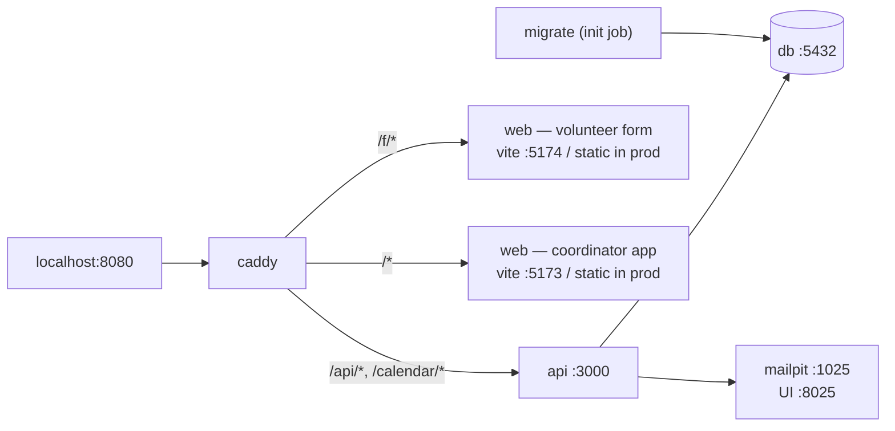

# 06 — Local development

## 1. Compose topology



Three files, one shape:

| File | Purpose |
| --- | --- |
| `compose.yaml` | The services that exist in every environment: `db`, `migrate`, `api`, `caddy` |
| `compose.override.yaml` | Applied automatically. Dev additions: `mailpit`, `web` running Vite, source bind mounts, `watchexec`, exposed `5432`, verbose logging |
| `compose.prod.yaml` | Pinned image tags, Docker secrets, a `backup` sidecar, no bind mounts, no exposed database port |

```
docker compose up                                        # dev
docker compose -f compose.yaml -f compose.prod.yaml up -d  # self-hosted prod
```

Keeping production a *subset* of development, rather than a separate file,
means a service that exists only in one of them is visible at a glance.

### Service notes

Supporting files, all under `docker/`:

| Path | |
| --- | --- |
| `db/init/` | Roles, ownership and default privileges. Run once, as the superuser, on an empty data directory — see [§2](#the-two-database-roles) |
| `db/backup.sh`, `db/restore.sh` | The production backup sidecar and its other half |
| `caddy/Caddyfile`, `caddy/Caddyfile.dev` | Two files, because dev proxies to a Vite server and production serves built assets. Different directives, not different values |
| `dev-config/` | `providers.toml` (empty — no OIDC provider) and the Dex fixture |
| `dev-secrets/` | Committed key fixtures, so a fresh clone needs no setup step. Mounted at `/run/dev-secrets`, a different path from production's `/run/secrets`, so a real deployment cannot silently fall back to them |
| `api/Dockerfile`, `web/Dockerfile` | Plus their `.dev` counterparts |

**`db`** — `postgres:17-alpine`, named volume `evp-pgdata`. Healthcheck is
`pg_isready`, and every other service waits on `service_healthy`. Dev tuning
(`fsync=off`, `synchronous_commit=off`) is set in the override file only; it
makes the test suite noticeably faster and would be reckless in production.

**`migrate`** — runs `evp migrate` as `evp_migrator` and exits. Not `sqlx
migrate run` directly: production passes `EVP_MIGRATION_DATABASE_URL_FILE`
because a connection URL embeds a password
([§2](#the-_file-suffix)), `sqlx-cli` only understands `DATABASE_URL`, and the
image has no shell to translate one into the other. Routing the migration
through the same binary that already implements the `_FILE` convention means
that rule has one implementation, not two
([ADR-0030](adr/0030-backend-dependency-selection.md)). `api` depends on
`migrate` with `condition: service_completed_successfully`. Migrations run as a
separate step with a separate, privileged role, so the API's own role can stay
unprivileged and RLS-bound.

**`api`** — in dev, source is bind-mounted and `watchexec --restart -- cargo
run` rebuilds on change; a named volume for `/app/target` keeps incremental
builds across container restarts. `cargo-watch`, named here in earlier drafts,
is not what the image installs: its last release is October 2024 and its own
README now points to `watchexec`
([ADR-0030](adr/0030-backend-dependency-selection.md)). In prod it is the
distroless image, read-only root filesystem, non-root user, `cap_drop: ALL`.

**`web`** — in dev, **two** Vite dev servers in one container, admin on `5173`
and the public form on `5174`, both proxied through Caddy so the browser sees
one origin and cookies behave exactly as they will in production. Two servers
rather than one because the two bundles are a security boundary
([02 §7](02-architecture.md#7-frontend-structure)), and a single dev server
serving both would let an import cross it and nothing would notice until the
production build. HMR has to be told to call back on `8080`
(`VITE_HMR_CLIENT_PORT`), since the browser cannot reach `5173` directly.

In prod the service does not exist: both bundles are baked into the Caddy
image, the form under `/f/` and the admin application at the root.

One origin is not a convenience. The session cookie is `SameSite=Lax; HttpOnly`
and CSRF is a double-submit token ([02 §8](02-architecture.md#8-cross-cutting-concerns));
a dev setup where the browser talks to Vite on one port and the API on another
is cross-origin, needs CORS and a different cookie policy, and postpones every
cookie bug to production.

**`mailpit`** — dev only. Catches all outbound mail; UI on `:8025`. Nothing in
development can email a real volunteer, which matters when the test data is
imported from a real spreadsheet.

**`dex`** — dev only, optional. A ~20 MB static-config OIDC provider, declared
in `providers.toml` like any other, so the whole
authorization-code-with-PKCE path can be exercised offline with no
real provider credentials and no internet access. Because the client is
generic, testing against Dex tests the same code that will run against Google
or Entra. The OIDC client itself is not built yet, so today Dex starts and
nothing talks to it.

Dex is also the documented production answer for anything the core does not
speak — LDAP, SAML, GitHub — put it in front and configure it as one provider
([ADR-0014](adr/0014-pluggable-oidc-providers.md)). It is dev-only in *this*
compose file, not dev-only as a pattern.

**Signing in today.** Password login is the only method built
([ADR-0031](adr/0031-password-bootstrap-credential.md)); magic links and OIDC
are not built yet. Set `EVP_BOOTSTRAP_USERNAME` (an email address) and
`EVP_BOOTSTRAP_PASSWORD` (12+ characters) in `.env` before the first
`just up`: the API creates that owner and an organisation while `users` is
empty, and you sign in at `/login`. Once magic links land they will work fully
offline via Mailpit, so a contributor with neither provider credentials nor
Dex can still sign in.

**`backup`** — prod only. `pg_dump` on a schedule to a mounted volume, with
retention. A restore script lives beside it and a restore drill is part of the
release checklist, because an untested backup is not a backup.

## 2. Configuration

Environment variables, parsed once at startup into a typed struct. The process
exits on anything missing or malformed rather than failing later.

| Variable | Example | Notes |
| --- | --- | --- |
| `EVP_DATABASE_URL` | `postgres://evp_api:…@db/evp` | The **unprivileged** role |
| `EVP_MIGRATION_DATABASE_URL` | `postgres://evp_migrator:…@db/evp` | Migration step only |
| `EVP_BIND` | `0.0.0.0:3000` | |
| `EVP_PUBLIC_URL` | `https://evp.example` | Used to build magic-link and ICS URLs |
| `EVP_SESSION_KEY_FILE` | `/run/secrets/session_key` | 32 random bytes; rotating it invalidates all sessions |
| `EVP_SECRET_KEY_FILE` | `/run/secrets/app_key` | 32 random bytes. Encrypts the values that must be *recoverable* rather than hashed — per-org OVH SMS credentials today ([ADR-0034](adr/0034-per-org-ovh-sms-credentials.md)), webhook signing secrets later ([08 §3](08-volunteer-intake.md#webhook-specifics)). Rotating it requires re-encrypting those; `evp-cli rotate-app-key` is reserved for that and is a stub today |
| `EVP_AUTH_CONFIG` | `/etc/evp/providers.toml` | The provider list. Absent → no OIDC provider, which is a valid deployment. Parsed at startup; the OIDC client that uses it is not built yet |
| `EVP_OIDC_ALLOWED_REDIRECTS` | `/,/events,/pool` | App-relative allow-list for `redirect_to` |
| `EVP_SMTP_URL` | `smtp://mailpit:1025` | Required at startup, though nothing sends mail until the outbox lands |
| `EVP_MAIL_FROM` | `planner@evp.example` | Required at startup, likewise unused today |
| `EVP_BOOTSTRAP_USERNAME` | `owner@example.org` | The first owner's email address. Read only while `users` is empty, so leaving it set is a no-op after the first start ([ADR-0031](adr/0031-password-bootstrap-credential.md)). Set with the password or not at all |
| `EVP_BOOTSTRAP_PASSWORD` | — | At least 12 characters. Prefer `EVP_BOOTSTRAP_PASSWORD_FILE` in production; startup warns on the plain form |
| `EVP_BOOTSTRAP_ORG_NAME` | `My organisation` | The organisation created alongside that owner. Defaults to `My organisation` |
| `EVP_SESSION_ABSOLUTE_LIFETIME_HOURS` | `12` | A session older than this is dead however active it has been |
| `EVP_SESSION_IDLE_TIMEOUT_MINUTES` | `480` | A session unused for this long is dead |
| `EVP_SMS_PROVIDER` | `ovh` \| `twilio` \| `none` | **Deprecated by [ADR-0034](adr/0034-per-org-ovh-sms-credentials.md).** OVH credentials are now per-organisation, stored encrypted in `org_sms_settings` and managed by a coordinator through the API rather than by this deployment-wide file secret. This variable, `EVP_SMS_CREDENTIALS_FILE` and `EVP_SMS_SENDER` are left in `config.rs` unused pending the outbox-wiring pass that removes them |
| `EVP_SMS_CREDENTIALS_FILE` | `/run/secrets/sms` | See above — superseded by ADR-0034 |
| `EVP_SMS_SENDER` | `Soundclash` | See above — superseded by ADR-0034 |
| `EVP_RUN_WORKER` | `true` | Lets the worker be split into its own container later |
| `EVP_LOG_FORMAT` | `json` \| `pretty` | |
| `EVP_RETENTION_SWEEP_ENABLED` | `true` | Disable only in dev. Production without it silently retains personal data |
| `EVP_SOURCE_URL` | `https://github.com/Trirandom/event-volunteer-planner` | Shown to every network user for AGPL §13. **A modified deployment must point this at its own fork.** |
| `EVP_RUST_LOG` | `evp=debug,tower_http=debug` | |
| `EVP_TRUSTED_PROXY_HOPS` | `1` | How many reverse proxies stand between the internet and the process. The login rate limit keys on the caller's address, which behind a proxy is only in `X-Forwarded-For`; this says how many entries from the *right* of that header were written by something this deployment controls. `1` is Caddy and matches both compose files. Too high lets a caller choose their own bucket by sending a header; too low puts everyone behind a proxy in one bucket |
| `EVP_LOGIN_RATE_LIMIT_BURST` | `10` | Sign-in attempts one address may make back to back. Sized for simultaneity — a dozen coordinators on one office NAT are one address — and it is also a memory bound, because each attempt in flight is an Argon2 verification holding ~19 MiB |
| `EVP_LOGIN_RATE_LIMIT_REPLENISH_SECONDS` | `15` | How long until one of those attempts comes back. This is the rate an attacker is left with |

Secrets are files (Compose `secrets`), never environment values, so they do not
appear in `docker inspect` or in a crash dump of the environment. OIDC client
secrets follow the same rule: `providers.toml` references them by path
(`client_secret_file`) and never contains them, so the file itself is safe to
keep in a config repository.

### The `_FILE` suffix

Any variable in the table above may instead be given as `<NAME>_FILE`, naming a
path whose contents are the value. Exactly one of the two forms may be set;
both is a startup error rather than a precedence rule nobody remembers.

It exists because **a connection string is itself a secret** — a URL embeds its
password, so passing `EVP_DATABASE_URL` as an environment value puts the
database password in `docker inspect` however carefully the password was
handled. Production therefore sets `EVP_DATABASE_URL_FILE` and
`EVP_MIGRATION_DATABASE_URL_FILE`; development sets the plain forms, because
there is nothing to protect. `EVP_SESSION_KEY_FILE`, `EVP_SECRET_KEY_FILE` and
`EVP_SMS_CREDENTIALS_FILE` in the table are this same convention, named
explicitly because they have no plain equivalent.

The Postgres image's own `POSTGRES_PASSWORD_FILE` follows the identical pattern,
and `docker/db/init/00-roles.sh` extends it to the two application roles
(`EVP_DB_MIGRATOR_PASSWORD_FILE`, `EVP_DB_API_PASSWORD_FILE`), so there is one
mechanism across the stack rather than three.

### The two database roles

`docker/db/init/` runs once, as the superuser, on an empty data directory, and
creates the separation that
[02 §4](02-architecture.md#4-multi-tenancy) depends on:

| Role | Owns | Used by |
| --- | --- | --- |
| `evp_migrator` | The database and every object in it | The `migrate` step only |
| `evp_api` | Nothing. `NOSUPERUSER`, `NOBYPASSRLS`, not a table owner | The API and worker |

Those three attributes are the entire tenant-isolation guarantee: RLS is
bypassed silently by a superuser, by `BYPASSRLS`, and by the owner of the table
being read, so the API must be none of the three. `ALTER DEFAULT PRIVILEGES` in
`10-grants.sql` gives `evp_api` its `SELECT/INSERT/UPDATE/DELETE` at table
*creation* time, so a migration written in two years produces a usable table
with nobody remembering to grant it — and the two tables where that default is
wrong (`audit_log` above all) revoke it in their own migration.

**The init scripts run exactly once.** Changing a development password after the
first start does nothing until `just db-reset`, which drops the volume.

### Auth providers

`providers.toml` is documented in
[ADR-0014](adr/0014-pluggable-oidc-providers.md). Three things about it here:

- **It is optional.** With no file, the deployment offers magic links only.
  That is the default `docker compose up` experience, and it is deliberately
  the one that needs no external account.
- **A bad entry refuses to boot.** An unreachable issuer, a discovery document
  whose `issuer` does not match, a missing secret file, or a provider `id` that
  conflicts with identities already in the database — all fail at startup, not
  at somebody's first login attempt.
- **`id` values are immutable.** They are stored in `identities.provider`;
  renaming one orphans every identity that used it. Startup checks the
  configured ids against distinct values already present in the table and
  refuses if one has vanished.

## 3. Day-to-day

A `justfile` wraps the common paths so nobody has to remember them
(`just --list` is authoritative):

```
just up / upd        # compose up with the dev override (upd: detached)
just down / nuke     # stop; nuke also destroys the volumes
just logs [svc]      # follow logs
just up-oidc         # also start Dex
just db-reset        # drop, recreate, migrate, seed
just migrate         # apply pending migrations without restarting the API
just migrate-new X   # scaffold a migration
just psql            # psql as evp_api — RLS applies
just psql-admin      # psql as evp_migrator
just bootstrap EMAIL # evp-cli create-org --owner-email … — stub, see below
just seed            # a realistic 3-day event at target scale — stub, see below
just reconcile ORG   # reconcile an org's `received` form submissions (ADR-0042)
just dump-example ORG [FESTIVAL]  # regenerate the worked example from a mock org
just check           # fmt, clippy -D warnings, sqlx prepare --check, prettier, eslint, tsc/vue-tsc
just test            # cargo nextest + vitest
just test-tz         # the Rust suite again under TZ=Pacific/Chatham
just mutants         # cargo-mutants over the pure crates — slower, run before a PR
just e2e             # Playwright; needs the stack up
just openapi         # regenerate openapi.json and the TS client — planned, see 11 §3
```

**`bootstrap` and `seed` are stubs today**: `evp-cli create-org` and
`evp-cli seed` exit with "lands with M0/M2", so `just db-reset` stops after
migrating. Until they land, the first owner comes from `EVP_BOOTSTRAP_*`
([§1](#1-compose-topology)) and data from the admin's "Load the example
festival" action (the Soundclash 26 worked example). What follows describes
the seed as specified.

The seed is also **not uniform**: at least one post runs the *artiste* division,
`45 / 45 / 90 / 45 / 45`, and at least one event day crosses nothing tidy. Any
code that assumes equal slot lengths — a rest calculation on a slot index, a
board that lays out fixed columns, a schedule email that counts slots instead of
hours — then fails in development rather than at the event
([ADR-0029](adr/0029-shift-patterns-are-generators-not-constraints.md)).

`just seed` producing data **at the stated target scale** is deliberate — 500
volunteers, not 300, because the target is 500
([01 §5](01-product-spec.md#5-non-functional-requirements)) and seeding below it
means the first honest performance test happens in production. Timeline
virtualisation, coverage query performance and the readability of a
500-volunteer picker are all invisible with five rows of test data, and all
three are the things most likely to be wrong.

`sqlx prepare --check` in `just check` is meant to make offline compile-time
query verification honest: it fails if a query was changed without
regenerating the cached metadata. **Today it checks nothing**: every query is
a runtime `sqlx::query*` call rather than a `query!` macro, and there is no
committed `.sqlx/` cache, so SQL is verified by the integration suite only
([11 §4](11-engineering-standards.md#4-sql-and-migrations)).

## 4. Testing strategy

Discipline — where test-first is required, and how test *efficacy* is gated —
is [13 — Testing and TDD](13-testing-and-tdd.md). This table is what runs where;
rows marked *(planned)* have no test yet because the feature does not exist.

| Level | Tool | What it covers |
| --- | --- | --- |
| Domain unit tests | `cargo test` in `evp-domain` | The constraint engine *(planned — the soft-warning engine is not built; the shift generator, captcha and submission parsing are tested)*. No database. Every rule gets a passing and a failing case, plus its boundary — a shift that ends exactly when another begins is not an overlap. |
| Repository / integration | `cargo test` against the Compose database | Each test opens one transaction as `evp_migrator` and never commits it, so nothing it does survives the run. Not `sqlx::test`: that creates a database per test and needs `CREATEDB`, which neither role has on purpose (`crates/evp-db/tests/catalog.rs`). `FORCE ROW LEVEL SECURITY` keeps the owner subject to the policies. Covers migrations, triggers, and every hard constraint by *attempting the violation and asserting the error code*. |
| Shift generation | `cargo test` | The pattern walk: `45/45/90/45/45` from 09:00 yields five shifts ending at 14:00; a tiled pattern reports its remainder and drops it; `once` overrunning the window is refused; a segment landing on a nonexistent local time is refused, not shifted; and a window crossing spring-forward keeps its local start times while producing a genuinely shorter shift ([ADR-0029](adr/0029-shift-patterns-are-generators-not-constraints.md)) |
| Route authorisation | Table-driven suite *(partial — `crates/evp-api/tests/route_role_matrix.rs` covers festivals and events)* | Every route against every role. A new route with no authorisation extractor fails here as well as failing to compile ([12 §4](12-security.md#4-authorisation-belongs-in-the-type-system)). |
| Tenant isolation | Per-module RLS tests *(schema-wide check planned)* | For every table with `org_id`: connect as `evp_api` with org A's setting, attempt to read and write org B's rows, assert zero rows and a policy violation. Plus the schema-wide check that no table with `org_id` lacks RLS — asserted today for the form tables only. |
| API contract | `cargo test` through the real router | Auth, status codes, `If-Match` behaviour, the problem+json shape. Snapshot-testing `openapi.json` is *(planned)* — no OpenAPI document is generated yet. |
| OIDC flow *(planned)* | `cargo test` against Dex | State mismatch, replayed `code`, expired/wrong-`aud`/wrong-`nonce` ID token, `iss` not matching discovery, `redirect_to` outside the allow-list — each refused. Plus the linking matrix: a **trusted** provider links to an existing user on verified email; an **untrusted** one never does and creates a separate account; `email_verified` absent is treated as false; `allowed_email_domains` is enforced; the last identity cannot be unlinked. |
| Provider config *(planned)* | `cargo test` | Startup refuses: unreachable issuer, mismatched discovery `issuer`, missing secret file, duplicate or vanished provider `id`. A malformed config must never boot into a half-working auth system. |
| Frontend unit | Vitest | Composables, especially timezone formatting and the timeline's time↔pixel maths. |
| Frontend component | Vitest + `@vue/test-utils` | The board's keyboard interaction model, since it is the accessibility guarantee and the easiest thing to regress. |
| End-to-end | Playwright | Today: the coordinator screens built so far (events, plan details, missions, shifts), i18n and the AGPL source notice, with axe on most. *(Planned)* four journeys: import a spreadsheet; plan and publish an event; a volunteer opening their **form token link** and declaring availability — volunteers never receive a magic link, they have no login at all ([ADR-0008](adr/0008-no-volunteer-authentication-in-v1.md)); and a volunteer exercising their rights from that same link, including erasure with its mail confirmation ([ADR-0027](adr/0027-volunteer-self-service-rights.md)). |
| Retention *(planned)* | `cargo test` | The sweep, against the schema: zero rows in every event-tier table, accountability rows intact, a payload expiring with no event involved, and a consented volunteer keeping a working form link. Run under the default policy and a non-default one. |
| Undo *(planned)* | `cargo test` through the real router | Each mutating endpoint's inverse round-trips; undo is refused after publication, after a conflicting later operation, and when it would violate a hard constraint ([ADR-0024](adr/0024-server-side-undo-and-per-item-bulk.md)). |

Two tests are worth singling out because they encode decisions that are easy
to silently break:

- **DST**: an event duplicated across a DST boundary keeps its local start
  times. A shift crossing spring-forward is 1 hour shorter in real time and the
  daily-hours rule agrees.
- **Concurrency**: two simultaneous requests assigning different volunteers to
  the last free slot of a shift — exactly one succeeds, and the loser gets a
  `422` naming the reason, not a 500.

## 5. CI

GitHub Actions runs the rows marked **runs** below, from
[`.github/workflows/ci.yml`](../.github/workflows/ci.yml) and
[`codeql.yml`](../.github/workflows/codeql.yml), on every push and pull
request. The rest are still planned, and for those the local recipes remain the
gate — `just e2e`, `just mutants` and `pnpm mutants` where a change warrants
them. `just check` and `just test` are still worth running before a push: they
are the same commands, minutes sooner. Each enforcement table
([11 §7](11-engineering-standards.md#7-enforcement-summary) and the four it
links) says which rows are enforced and where.

On `main`, once every check has passed, `ci.yml` builds the image of each
service whose inputs changed since the previous push — `api`, `migrate`,
`web` — scans it, and pushes it to
`ghcr.io/trirandom/event-volunteer-planner/<service>` tagged `sha-<commit>`
(what `EVP_VERSION` names) and `main`. Pull requests build and scan the same
images without pushing them.

| Job | Stage | Status | |
| --- | --- | --- | --- |
| `fmt` / `clippy` | check | runs — `rust-lint` | `-D warnings`, lints inherited from `[workspace.lints]` ([11 §2](11-engineering-standards.md#2-rust)) |
| `sqlx-check` | check | planned | `cargo sqlx prepare --check` against a service Postgres — meaningful once queries move to the macros ([11 §4](11-engineering-standards.md#4-sql-and-migrations)) |
| `web-lint` | check | runs — `web`, with `prettier --check` | eslint `strictTypeChecked` + `tsc --noEmit` + `vue-tsc --noEmit` ([11 §3](11-engineering-standards.md#3-typescript)) |
| `no-dynamic-sql` | check | planned | Greps for SQL assembled by string formatting ([12 §3](12-security.md#3-the-database-boundary)) |
| `api-client-fresh` | check | planned | Regenerates the TS client from OpenAPI and fails on a diff — once there is a generated client |
| `rust-test` | test | runs — Postgres via `docker compose up db`, so the roles in `docker/db/init/` exist | with a `postgres:17` service |
| `web-test` | test | runs — `web` | vitest |
| `e2e` | test | planned | Playwright against a Compose stack |
| `build-api` / `build-web` | build | runs — `image`, per changed service; pushed from `main` only | Buildx with layer cache, pushed to `ghcr.io` |
| `oidc-test` | test | planned | with a `dex` service, so the login path is covered without Google |
| `mutants` | test | planned | `cargo-mutants` on `evp-domain`, `evp-intake` and the authz extractors; zero survivors required ([13 §9](13-testing-and-tdd.md#9-mutation-testing-the-efficacy-gate)) |
| `coverage` | test | planned | `cargo-llvm-cov`, ratcheted against the base branch — may not decrease |
| `mutants-nightly` | test | planned | The rest of the workspace, reported not blocking |
| `tz-hostile` | test | runs — second pass in `rust-test` | The whole suite again under `TZ=Pacific/Chatham` (+12:45, own DST) — proves storage is server-timezone independent ([16 §7](16-i18n-and-time.md#7-enforcement)) |
| `a11y` | test | planned | `@axe-core/playwright`, zero violations; plus the keyboard-only journey ([14 §7](14-accessibility-and-interaction.md#7-enforcement)) |
| `retention` | test | planned | Asserts every table has a `retention_scope` tier, that the sweep empties the event tier and preserves the accountability tier, and that the two age-based clocks fire — under the default policy **and a non-default one** ([15 §9](15-privacy-and-retention.md#9-enforcement)) |
| `stryker` | test | planned | Mutation testing over the frontend's pure composables — the time↔pixel scale and the availability merge ([13 §9](13-testing-and-tdd.md#9-mutation-testing-the-efficacy-gate)) |
| `test-touched` | check | planned | Warns, without blocking, when `src/**` changes with no test change ([13 §12](13-testing-and-tdd.md#12-enforcement)) |
| CodeQL / secret scanning / Dependabot | security | runs — `codeql.yml` (Actions, TS, Rust), gitleaks over the whole history (`secrets`), `.github/dependabot.yml`, and `dependency-review` on pull requests | GitHub's own: static analysis, committed-secret detection, dependency alerts |
| `container-scanning` | security | partial — Grype in `image`, report-only until the base images are clean (see the comment there) | An image scanner over the built images |
| `dco-check` | check | planned | Every commit carries `Signed-off-by` |
| `cargo-deny` | security | runs — `cargo-deny` | RUSTSEC advisories, plus the AGPL-compatible licence allow-list; SSPL/BUSL/Elastic denied outright. Also runnable locally as `cargo deny check` |
| `web-licences` | security | partial — `dependency-review` applies the allow-list to what a pull request adds; `pnpm audit --prod` runs as `npm-audit` | The same allow-list over the npm tree |
| `deploy` | deploy | planned | Manual, `main` only |

`cargo-deny` is listed separately from Dependabot because the latter's Rust
coverage is thinner than `RUSTSEC`. It also carries the licence
allow-list, which matters more than usual under AGPL: a source-available
dependency (SSPL, BUSL) cannot legally be combined, and the failure mode is
discovering it after publication. See
[CONTRIBUTING.md](../CONTRIBUTING.md#dependencies).
