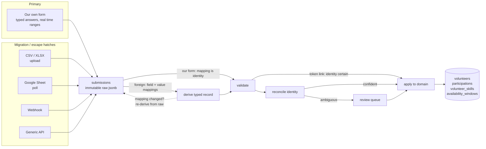

# 08 — Volunteer intake

Volunteers do not log in ([ADR-0008](adr/0008-no-volunteer-authentication-in-v1.md)).
Everything they tell the organisation — contact details, skills, availability,
T-shirt size, dietary needs — arrives through a **form**, and that form is
[our own](09-volunteer-form.md)
([ADR-0010](adr/0010-first-party-form-as-primary-intake.md)).

This document is the pipeline that turns form answers into domain data:
storage, mapping, validation, identity reconciliation, review, and replay. It
is deliberately **source-agnostic**, because two kinds of input have to flow
through it:

| Source | Role | Mapping needed? |
| --- | --- | --- |
| **Our own form** | Primary, ongoing | **No.** Our fields, so mapping is identity and the answers are already typed. |
| CSV / XLSX upload | One-time migration of the existing spreadsheet | Yes — arbitrary columns |
| Google Sheet poll, webhook, generic API | Optional escape hatches, not on the roadmap | Yes |

So the mapping machinery in §4 is **migration tooling and an escape hatch**,
not the everyday path. It is documented in full because the migration is real,
high-stakes and happens once, and because the source abstraction is what keeps
a future external form from being a rewrite.

The stages that apply to *every* source — immutable raw payloads, identity
reconciliation, the review queue, replay, audit — are the ones that matter
daily. Those are §2, §6, §8.

## 1. The problem, precisely

A form response is hostile input in a specific way. It is not malicious; it is
*shapeless*.

| Reality | Consequence | Applies to |
| --- | --- | --- |
| People submit twice, and change their mind | Later submissions must supersede earlier ones without losing history | **All sources** |
| Identity is claimed, not proven | Matching a response to a person is a heuristic, and it will be wrong sometimes | Public + foreign |
| A coordinator fixes a name by hand, then an import runs | Manual corrections must not be clobbered | **All sources** |
| The same payload arrives twice | Intake must be idempotent | **All sources** |
| An interpretation turns out to be wrong | Repair must not require re-asking anyone | **All sources** |
| `"Prénom et nom"` is one field; the schema wants two | Mapping must split one answer into several targets | Foreign only |
| T-shirt answers are `"Large"`, `"L"`, `"l"`, `"grand"` | Normalisation is per-value, not per-field | Foreign only |
| A coordinator edits the source form mid-campaign | Columns move, and a naive importer silently writes phone numbers into `notes` | Foreign only |
| Availability arrives as checkbox labels | A label must resolve to a `tstzrange` | Foreign only |

Note how the bottom four vanish for our own form. Its fields are known, its
answers are typed, its availability arrives as real time ranges, and editing it
produces a **new version** rather than drift
([09 §2](09-volunteer-form.md#2-versioning-replaces-drift-detection)). That
collapse is most of the argument in
[ADR-0010](adr/0010-first-party-form-as-primary-intake.md).

The top five remain, whoever wrote the form. They are the reason this is a
pipeline rather than an import function.

## 2. Design: a staged, replayable pipeline



The load-bearing property is that dashed arrow. **Raw submissions are stored
immutably and separately from the mapping that interprets them** — literally
separately, in `submission_payloads`, so that expiring them is a row deletion
rather than an overwrite ([03 §3.10](03-data-model.md#310-intake)).
Consequences:

- Got the mapping wrong? Fix it and replay. No re-export from Google, no
  re-asking 300 volunteers.
- Forgot to define a "Sunday night" availability slot? Define it, replay, and
  the availability windows appear.
- Need to know why a volunteer's record says what it says? The raw answer is
  still there, with its timestamp and source — for as long as the payload lives,
  which is 30 days by default. Replay is a repair window, not an archive
  ([15 §5](15-privacy-and-retention.md#two-clocks-that-are-not-the-events)):
  the payload is a verbatim copy of everything a volunteer typed, and keeping it
  indefinitely to enable a repair nobody has needed since is the wrong trade.
  After it expires, `submissions.raw_keys` still records which fields were
  present, so the history reads coherently.

An importer that parses and writes in one pass has none of this, and every
mapping mistake becomes a data-repair job.

## 3. Sources

Ordered by the effort-to-value ratio.

| Source | Mechanism | Latency | Roadmap |
| --- | --- | --- | --- |
| **First-party form** | Rendered by us; answers posted directly | instant | **M1 — primary.** [09](09-volunteer-form.md) |
| **CSV / XLSX upload** | Upload → map → commit | manual | **M1 — migration.** Loads the existing spreadsheet |
| Google Sheet poll | Service account, `spreadsheets.values.get`, cursor-based | ~5 min | Not scheduled |
| Webhook | `POST /intake/hooks/{source_id}`, HMAC-verified | seconds | Not scheduled |
| Generic API | `POST /api/v1/intake/{source_id}/submissions`, API key | seconds | Not scheduled |

The last three are specified because the source abstraction makes them cheap
and because an organisation may insist on its own Google Form. None is on the
roadmap: the first-party form covers the need, and covers it better.

### First-party form

Answers are posted straight to the API by the form bundle, validated against
the `form_version` they were rendered from, and stored as a submission like any
other. No polling, no mapping, no drift. Detail in
[09 — Volunteer form](09-volunteer-form.md).

### Google Sheets specifics

Authentication is a **service account**: the coordinator shares the Sheet with
the service account's email address, and that is the entire setup. No OAuth
consent flow, no refresh tokens to store and rotate, no re-consent when a
token is revoked. The trade-off is one manual sharing step per source, which
is acceptable for something configured once per campaign.

Polling reads from a stored `last_row` cursor rather than re-reading the sheet,
and `A1` notation is resolved from the header row each poll so that drift is
*detected* (§7) rather than absorbed.

### Webhook specifics

Two different secrets, stored two different ways — a distinction that is easy
to get wrong:

- **Webhook signing secrets** must be recoverable, because verifying an HMAC
  requires the secret itself. Stored encrypted at rest with the application key
  (`EVP_SECRET_KEY_FILE`, [06 §2](06-local-development.md#2-configuration)),
  never hashed.
- **API keys** for the generic endpoint are only ever *compared*, so they are
  stored as SHA-256 hashes and shown to the user exactly once at creation.

Webhook handlers reply `202` immediately after signature verification and
persisting the raw body. Mapping happens in the outbox worker: a provider
retrying because our mapper was slow is a bad failure mode.

## 4. Field mapping

A source has **fields** (its questions, as we discovered them) and each field
has zero or more **mappings** onto domain targets.

### Target kinds

| `target_kind` | `target_path` example | Produces |
| --- | --- | --- |
| `volunteer_field` | `volunteer.display_name`, `volunteer.first_name` | A column on `volunteers` |
| `participation_field` | `participation.tshirt_size`, `participation.is_adult` | A column on `participations` |
| `skill` | — (`skill_id` on the value mapping) | Rows in `volunteer_skills` |
| `availability` | — (`slot_option_id` on the value mapping) | Rows in `availability_windows` |
| `identity` | `volunteer.email` | Used for reconciliation (§6), and written. Unique per organisation, so it identifies exactly one volunteer ([ADR-0028](adr/0028-one-volunteer-one-email.md)) |
| `reserved` | `submitted_at` | A field the pipeline itself consumes rather than a domain column — the provider's own timestamp is the only one so far |
| `ignore` | — | Explicitly discarded, so it stops appearing as unmapped |

`ignore` exists so that "unmapped fields" means "fields nobody has looked at",
which is what makes the drift check in §7 useful. A field left unmapped by
oversight and a field deliberately dropped must not look the same.

### Transforms

Applied in order, per mapping:

```json
{ "trim": true, "collapse_whitespace": true, "lowercase": false,
  "split": { "on": " ", "take": 0 },
  "date_format": "%d/%m/%Y",
  "empty_as_null": true }
```

`split` lets one field feed several targets, which is why the schema allows
several mappings per field rather than one.

**Do not use it for names.** `volunteers.display_name` holds the name verbatim
and is never parsed. The real pool contains mononyms, stage names, a name with
an emoji, and four-token names; splitting would be wrong for most of it, and
for a mononym it would have to invent a surname
([ADR-0012](adr/0012-name-parts-asked-not-parsed.md)). A combined name column
maps straight to `display_name`, leaving `first_name` and `last_name` `NULL`.

A source that has *genuinely separate* first- and last-name columns — our own
form does — maps each to its own target directly. That is asking, not parsing,
and it is fine. For the legacy import, a coordinator-confirmed split assistant
can suggest parts row by row afterwards; nothing is written unconfirmed.

`split` remains useful for foreign sources with a genuinely compound column —
`"City, Postcode"`, or a date range in one cell.

### Value mappings

Field mapping says *where* an answer goes. Value mapping says what the answer
*means*. This layer is the one most importers omit and then hard-code.

```
external_value          → canonical
"Large", "L", "grand"   → "L"
"Végétarien", "veggie"  → "vegetarian"
"Oui"                   → grant skill first_aid
"Samedi matin (8h-12h)" → slot option "Saturday morning"
```

Unrecognised values do not silently pass through: the submission enters
`needs_review` with the offending value named. A per-mapping
`allow_unmapped_values` flag relaxes this for genuinely free-text fields.

### Availability: slot options

**Demoted by [ADR-0010](adr/0010-first-party-form-as-primary-intake.md).** Our
own form submits real `tstzrange` values, so nothing needs resolving. Slot
options survive in two smaller roles: mapping a *foreign* form's checkbox
labels, and supplying the suggested chips in our picker
([09 §3](09-volunteer-form.md#3-the-availability-picker)) for volunteers who
would rather tap "Saturday afternoon" than drag.

The event defines a catalogue of named windows:

```sql
intake_slot_options: (event_id, label, period, sort_order)
  'Saturday morning'   → [2026-07-04 08:00+02, 2026-07-04 12:00+02)
  'Saturday afternoon' → [2026-07-04 12:00+02, 2026-07-04 18:00+02)
  'Saturday night'     → [2026-07-04 18:00+02, 2026-07-05 02:00+02)
```

A multi-choice answer maps to a set of these, which become
`availability_windows` of kind `available`. Adjacent selected windows are
merged before insert, so "Saturday morning + Saturday afternoon" becomes one
08:00–18:00 window rather than two — which matters because the
`outside_availability` rule tests containment, and a shift spanning 11:00–13:00
would otherwise match neither.

In our own form these are *suggestions*, adjustable after tapping. For a
foreign form they are the only available precision, which is precisely the
limitation ADR-0010 rejected.

### The mapping, end to end

A real Google Form, and its persisted mapping:

| Sheet column | Mapped to |
| --- | --- |
| `Horodateur` | `submitted_at` (reserved target) |
| `Prénom et nom` | `volunteer.display_name` — stored verbatim, **not** split |
| `Adresse e-mail` | `identity` → `volunteer.email` |
| `Téléphone` | `volunteer.phone` |
| `Quels créneaux peux-tu assurer ?` | `availability` (multi-choice → slot options) |
| `As-tu le PSC1 ?` | `skill` (`Oui` → `first_aid`) |
| `Taille de t-shirt` | `participation.tshirt_size` (value-mapped) |
| `Régime alimentaire` | `participation.meal_plan` (value-mapped) |
| `Remarques` | `volunteer.notes` |
| `Score` | `ignore` |

```json
{
  "source_id": "018f…",
  "mappings": [
    { "external_key": "prenom_et_nom", "target_kind": "volunteer_field",
      "target_path": "volunteer.display_name",
      "transform": { "trim": true, "collapse_whitespace": true },
      "is_required": true },
    // our own form instead sends two separate questions, mapped directly:
    //   "prenom"  -> volunteer.first_name
    //   "nom"     -> volunteer.last_name
    { "external_key": "adresse_e_mail", "target_kind": "identity",
      "target_path": "volunteer.email",
      "transform": { "trim": true, "lowercase": true }, "is_required": true },
    { "external_key": "quels_creneaux_peux_tu_assurer",
      "target_kind": "availability", "separator": ", " },
    { "external_key": "as_tu_le_psc1", "target_kind": "skill" },
    { "external_key": "taille_de_t_shirt", "target_kind": "participation_field",
      "target_path": "participation.tshirt_size" }
  ]
}
```

## 5. Data model

Additions to [03 — Data model](03-data-model.md); the DDL lives there.

```
intake_sources        one configured origin (a form, a sheet, a webhook)
intake_fields         its questions, as discovered — external_key, label, type
intake_field_mappings field → domain target, with transforms
intake_value_mappings answer value → canonical value / skill / slot option
intake_slot_options   named availability windows, per event
submission_batches    one upload or one poll cycle
submissions           provenance + reconciliation state, retained
submission_payloads   the verbatim answers, immutable, expiring by age
```

### `external_key` versus `external_label`

Worth separating, because the two source families behave differently:

- **Typeform, Tally, our own form** issue a stable field *id*. The question
  text can be reworded freely and the mapping survives.
- **Google Sheets** gives only the column header, which *is* the question text.
  There is no stable id, so `external_key` is a normalised slug of the header
  (`Prénom et nom` → `prenom_et_nom`) and rewording the question breaks the
  mapping.

The second case is the common one, so it gets the drift machinery in §7 rather
than being wished away.

## 6. Identity reconciliation

Most form responses have no reliable identity. The exception is the one that
matters most in practice, and it comes first:

| Step | Condition | Result |
| --- | --- | --- |
| 0 | Submitted through a **per-volunteer token link** | `token` → identity is certain, apply directly. No matching, no review. |
| 1 | `(source_id, external_id)` already stored | Idempotent. Content identical → skip. Content differs → treat as a revision (§8). |
| 2 | Mapped email matches a volunteer's email exactly (case-insensitive) | `exact_email` → apply. Unambiguous by construction: the address is unique per organisation ([ADR-0028](adr/0028-one-volunteer-one-email.md)). Unless the name disagrees (neither the first name matches nor the display name is similar above the threshold): then `needs_review` with an `email_in_use` error ([ADR-0042](adr/0042-public-submissions-reconciled-inline.md)) |
| 3 | No email, or unknown email; **and** `display_name_norm` is a trigram match above threshold **and** a corroborating field agrees — `last_name` or phone | `fuzzy_confirmed` → apply |
| 4 | Name matches one or more volunteers, nothing corroborates | `needs_review`, with ranked candidates |
| 5 | No candidate | `new` → create volunteer |

**Names never auto-match alone.** A trigram hit on "Martin Dupont" is as
likely to be a second Martin Dupont as a typo of the first, and an automatic
merge of two people is far more damaging — and far harder to unpick — than a
duplicate record a coordinator merges in ten seconds. Step 3 requires a second
corroborating field for exactly this reason.

`last_name` is the more useful of the two, because the form always asks for it
and volunteers reliably answer, whereas phone numbers are entered
inconsistently. Birthdate was a third option until it was dropped as unnecessary
([ADR-0022](adr/0022-no-birthdate-collected.md)), which cost little for the same
reason. That is a point
[ADR-0011](adr/0011-single-display-name-not-first-last.md) missed when it
removed the column, and part of why
[ADR-0012](adr/0012-name-parts-asked-not-parsed.md) supersedes it.

The previous system is the cautionary case: it used the lowercased name *as*
the identity, and the exported pool contains two people whose name differs
between sheets only by a double space or a surname's casing. Under name-keyed
matching those become orphans, and an orphan silently receives a "we couldn't
assign you any slots" message. `display_name_norm` collapses exactly those two
defects — but it feeds matching only, never identity
([10 §3](10-prior-art-spreadsheet.md#3-the-other-real-limits)).

Email normalisation is deliberately conservative: trim and lowercase only.
Gmail's dot-and-plus equivalence is *not* applied by default, because it is a
Gmail-specific behaviour and treating `j.dupont@` and `jdupont@` as one person
is a guess. It is available as a per-organisation setting.

Step 0 is why token links are worth issuing to everyone already in the pool:
it removes the entire class of matching error for the majority of responses,
and leaves the ladder to handle genuinely new people arriving through the
public link. The review queue shrinks to actual strangers.

The review queue is `submissions WHERE state = 'needs_review'`, presented as a
side-by-side of the incoming answers against each candidate volunteer, with
`match`, `create new`, and `reject` actions. Every decision is recorded in
`audit_log`, and a manual match teaches nothing automatically — no learned
matching in v1, because a matcher that improves silently is a matcher whose
mistakes are unexplainable.

## 7. Schema drift

**Foreign sources only.** Our own form has no drift: a submission pins to the
`form_version_id` it answered, so editing a live form is safe by construction
([09 §2](09-volunteer-form.md#2-versioning-replaces-drift-detection)). What
follows applies to CSV, Sheets, webhooks and the generic API — sources whose
question set we do not control and cannot version.

The failure it prevents: a coordinator inserts a question into the Google Form
on Tuesday, and Wednesday's import writes phone numbers into `notes` for 60
people.

Each source stores a `schema_fingerprint` — a hash of its sorted set of
`external_key`s. On every upload or poll, the fingerprint is recomputed:

| Change | Behaviour |
| --- | --- |
| Fingerprint unchanged | Proceed normally |
| New keys appear | Batch is accepted but **held**, not applied. New fields are created as unmapped, and the coordinator is prompted to map or `ignore` them. |
| A key with a `is_required` mapping disappears | Batch is **refused entirely**. Nothing is applied. |
| A key with an optional mapping disappears | Batch held; the mapping is flagged stale. |
| Column order changes, keys unchanged | Proceed — mapping is by key, never by position |

Mapping by key and never by position is what makes reordering harmless. It is
also why the CSV importer requires a header row and refuses files without one,
rather than falling back to column indices.

Refusing the whole batch when a required field vanishes is the deliberate
choice over importing what is available. A partial import of a form that has
changed shape produces records that look complete and are not, and nobody goes
back to check.

## 8. Revisions and precedence

People submit twice — and with token links, revising is an intended workflow
rather than an accident. A response arriving for an identity that already has
one:

- The new submission gets `supersedes_id` pointing at the previous one; the
  previous moves to state `superseded`. Nothing is deleted.
- **Availability is replaced wholesale**, not merged — consistent with the
  `PUT …/availability` semantics in [04 — API](04-api.md). A volunteer
  resubmitting with fewer slots means they are less available, and merging
  would make it impossible to withdraw availability.
- **Skills are additive by default.** A form usually asks "which of these do
  you have", so an unticked box is weak evidence of absence. Removal is a
  coordinator action. Configurable per mapping.
- **Scalar fields: last non-empty value wins**, with one exception below.

### Coordinator edits win

`volunteers.locked_fields text[]` records the columns a coordinator has edited
by hand. Intake never writes a locked field.

This is the cheap version of full per-field provenance, and it is chosen
deliberately over the general solution. The scenario is concrete: a
coordinator fixes a misspelled surname, then a re-import or a resubmission
overwrites it from the same bad form answer, and the coordinator gives up on
the tool. One array column stops that; a provenance table on every field would
cost far more and answer a question nobody has asked.

## 9. Our own form as a source

The first-party form is `intake_sources.kind = 'internal_form'`, and it flows
through this same pipeline — but most of the pipeline's difficulty does not
apply to it:

| Stage | Foreign source | Our form |
| --- | --- | --- |
| Field discovery | Inferred from headers or provider metadata | Authored. `form_questions` *is* the definition. |
| Field mapping | Configured per source, previewed, fallible | Identity — each question carries its `target_path` |
| Value mapping | Needed (`"Large"` → `"L"`) | Not needed — options carry canonical values and `skill_id` |
| Availability | Label → slot option → range | Submitted as real ranges |
| Drift | Fingerprint, hold or refuse the batch | Solved: submissions pin to `form_version_id` |
| Identity | Reconciliation ladder | Certain on the token route; ladder on the public route, run inline as the submission is stored ([ADR-0042](adr/0042-public-submissions-reconciled-inline.md)) |
| Raw storage, replay, review, audit | Same | Same — including that the payload expires on its own clock |

The rows that stay the same are the ones worth having built the pipeline for.
Immutable raw payloads and replay still matter for our own form: a question
mis-targeted at the wrong column is fixed by correcting the question and
replaying, not by re-asking three hundred people.

Design of the form itself — question types, the availability picker, token
links, anti-abuse, localisation — is [09 — Volunteer form](09-volunteer-form.md).

## 10. Volunteers revising their own answers

Previously filed as future work; **shipped in v1** as a consequence of owning
the form.

A per-volunteer **token link** ([09 §4](09-volunteer-form.md#4-reaching-the-form))
is an unguessable capability URL — the same primitive as the ICS feed, not a
login. It is reusable and long-lived, so reopening it shows the volunteer their
previous answers and submitting again supersedes them under the §8 rules.
Identity is certain, so no reconciliation is involved.

This does **not** extend to volunteers changing their *assignments*. Swapping
shifts between volunteers needs a proposal/acceptance state machine,
coordinator approval, and an identity that is stronger than a forwardable link
— it remains a v2 feature that revisits
[ADR-0008](adr/0008-no-volunteer-authentication-in-v1.md).

## 11. Failure catalogue

The cases the implementation must handle, gathered so the tests can be written
straight from them:

| Case | Expected behaviour |
| --- | --- |
| Same CSV uploaded twice | Second upload applies nothing; reported as 0 created, 0 updated |
| Two byte-identical rows in one CSV | Both retained — `external_id` is content hash + occurrence index. Reconciliation then supersedes, so one volunteer results. |
| Answer maps to an unknown value | `needs_review`, value named, nothing applied |
| Availability label not in the slot catalogue (foreign source) | `needs_review`; adding the option and replaying resolves it |
| Our own form's question is retargeted after answers exist | Fix the question, replay. Raw answers are untouched, so no one is re-asked. |
| Two volunteers share an email address (a couple) | **Refused, not queued.** An address identifies at most one volunteer ([ADR-0028](adr/0028-one-volunteer-one-email.md)): the first owns it, and a submission claiming it while asserting a different person enters `needs_review` naming the conflict. The coordinator confirms it is the same person, gives the second their own address, or records them with none. |
| Email present but empty string | Treated as absent; falls through to fuzzy matching |
| Form asks for availability before shifts are planned | Availability is independent of shifts, so this is fine and is the normal order |
| Google Sheet row deleted after import | No effect — submissions are ours once received |
| Webhook delivered twice | `UNIQUE (source_id, external_id)` makes it a no-op |
| Webhook signature invalid | `401`, body discarded, logged with source IP |
| Sheet poll runs while a coordinator is mid-edit | Header row read per poll; a torn read fails the fingerprint check and holds the batch |
| Timezone: a form filled in August about a July event | Answers carry absolute instants in the event timezone, so submission time is irrelevant |
| A public submission and a token submission for one person | Token submission wins; the public one is superseded |
